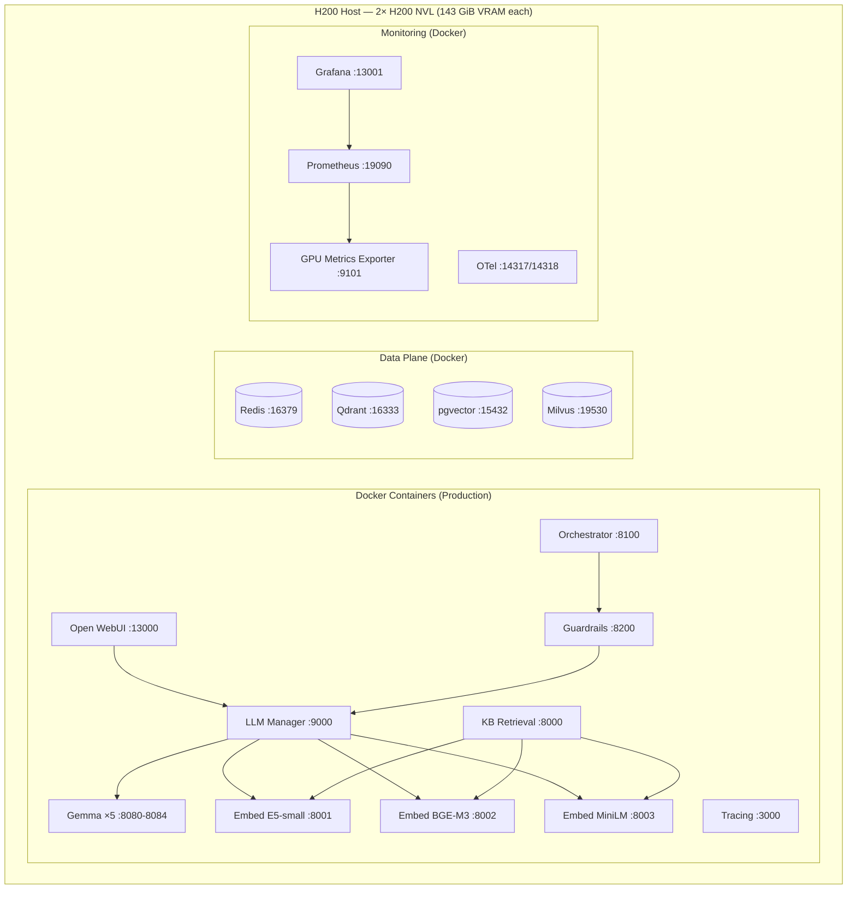

# Work RAG Server Setup — H200 DevOps, Containerization & Production Readiness

**Repository:** `Work_RAG-Server-Setup` (GitHub: `AliNikkhah2001/Work_RAG-Server-Setup`)  
**Branch:** `main`  
**Target Host:** 2× NVIDIA H200 NVL (ai-gpu1), Docker available, self-hosted Jenkins as root  
**Registry:** Local H200 Docker registry (`local-h200:5000`)  
**Corporate Proxy:** `http://192.168.203.2:3128` (Squid — all outbound traffic)

> The full **verified runbook** (live-tested on `ai-gpu1`) is preserved at [`README.runbook.md`](README.runbook.md).  
> This README is the **DevOps & operations reference**: Docker envs, Jenkins CI/CD, Triton/TensorRT model serving, monitoring, containerization migration, and production procedures.

---

## Table of Contents

- [1. System Overview](#1-system-overview)
- [2. Architecture & Service Topology](#2-architecture--service-topology)
- [3. Port Map](#3-port-map)
- [4. Docker Environment — Containerized Services](#4-docker-environment--containerized-services)
- [5. CI/CD — Self-Hosted Jenkins](#5-cicd--self-hosted-jenkins)
- [6. Model Serving — Triton / TensorRT-LLM Optimization](#6-model-serving--triton--tensorrt-llm-optimization)
- [7. Monitoring & Observability](#7-monitoring--observability)
- [8. Containerization Migration Plan (Zero-Downtime)](#8-containerization-migration-plan-zero-downtime)
- [9. Offline Provisioning Behind Corporate Proxy](#9-offline-provisioning-behind-corporate-proxy)
- [10. Core Services Details](#10-core-services-details)
- [11. Repository Layout](#11-repository-layout)
- [12. Run & Verify](#12-run--verify)
- [13. Planning & Progress Checklist](#13-planning--progress-checklist)
- [14. Known Gotchas](#14-known-gotchas)
- [15. License](#15-license)

---

## 1. System Overview

This component owns **hardware, model lifecycle, container infrastructure, CI/CD, and frontend wiring** for the Work Credit RAG platform on a 2× H200 NVL host. It is responsible for:

| Responsibility | Details |
|---|---|
| **Host bootstrap** | H200 GPU host behind corporate Squid proxy (scripts + offline-prep tooling) |
| **Embedding microservices** | 3× models (E5-small, BGE-M3, MiniLM) on ports 8001–8003 |
| **LLM Inference Manager gateway** | Port 9000 — OpenAI-compatible gateway, 11-model registry, round-robin |
| **Docker data plane** | Milvus/Qdrant/pgvector/Redis/Open WebUI |
| **Monitoring stack** | Prometheus/Grafana/OpenTelemetry + GPU metrics exporter |
| **Containerization** | All 7 production services containerized via Docker Compose |
| **CI/CD** | Self-hosted Jenkins on H200, GitHub webhooks, pipeline per service |
| **Model optimization** | TensorRT-LLM + Triton for Gemma-4-31B (FP8 KV cache, continuous batching) |
| **Persian benchmark harness** | 7-task evaluation with generated reports + GitHub Pages docs site |

---

## 2. Architecture & Service Topology



### Service Dependency Chain (Request Flow)

```
Browser :13000 → Open WebUI → Orchestrator :8100
  → Guardrails :8200 (input rails)
  → KB :8000 (retrieval)
  → Guardrails :8200 (guarded generate)
  → Gemma :18000 (llama-server) OR :9000 (Manager → 8080-8084)
  → Guardrails output rails
  → Orchestrator format_response → Open WebUI → Browser
  → Async trace → Langfuse :3001 / fallback :3000
```

---

## 3. Port Map

| Port(s) | Service | Production? | Containerized? |
|---|---|---|---|
| **8000** | KB Retrieval (pgvector HNSW + BM25 + RRF + rerank) | ✅ Yes | ✅ Yes |
| **8001–8003** | Embedding ×3 (e5-small / bge-m3 / MiniLM) | ✅ Yes | ✅ Yes |
| **8080–8084** | Gemma-4-31B ×5 (llama.cpp backends) | ✅ Yes | ✅ Yes (GPU) |
| **8090** | Qwen2.5-7B | ✅ Yes | ✅ Yes |
| **9000** | LLM Inference Manager (OpenAI-compatible gateway) | ✅ Yes | ✅ Yes |
| **9001** | DeepSeek-V4-Flash wrapper | ✅ Yes | ✅ Yes |
| **9621** | LightRAG | ⚠️ Optional | ✅ Yes |
| **13000** | Open WebUI (frontend) | ✅ Yes | ✅ Yes (existing) |
| **15432** | pgvector (Docker) | ✅ Yes | ✅ Yes |
| **16333 / 16334** | Qdrant (Docker) | ✅ Yes | ✅ Yes |
| **16379** | Redis cache (Docker) | ✅ Yes | ✅ Yes |
| **19530** | Milvus (Docker) | ✅ Yes | ✅ Yes |
| **13001** | Grafana | ✅ Yes | ✅ Yes |
| **19090** | Prometheus | ✅ Yes | ✅ Yes |
| **19100** | node-exporter | ✅ Yes | ✅ Yes |
| **14317 / 14318 / 19092** | OTel Collector (gRPC / HTTP / prometheus export) | ✅ Yes | ✅ Yes |
| **8010** | Gemma TRT-LLM BF16 champion | ✅ Yes | ✅ Yes (Triton) |
| **8011** | Gemma TRT-LLM FP8-KV variant | ⚠️ Validated only | ✅ Yes (Triton) |
| **18000** | Gemma llama-server (Vast.ai / loopback) | ⚠️ Vast only | ❌ No |

---

## 4. Docker Environment — Containerized Services

All 7 production services are containerized. Build from the `Work_Credit-RAG_Phase1` parent repo root:

```bash
# Build all images (requires Docker daemon + proxy configured)
bash Work_RAG-Server-Setup/deploy/docker/build-all.sh local-h200:5000
```

### 4.1 Dockerfiles (`deploy/docker/`)

| Dockerfile | Service | Base Image | GPU | Port |
|---|---|---|---|---|
| `Dockerfile.kb` | KB Retrieval | `python:3.11-slim` | No | 8000 |
| `Dockerfile.guardrails` | Guardrails (Persian policy) | `python:3.11-slim` | No | 8200 |
| `Dockerfile.orchestrator` | LangGraph Orchestrator | `python:3.11-slim` | No | 8100 |
| `Dockerfile.tracing` | Fallback trace collector | `python:3.11-slim` | No | 3000 |
| `Dockerfile.manager` | LLM Inference Manager | `python:3.11-slim` | No | 9000 |
| `Dockerfile.gemma` | Gemma ×5 backends | `nvidia/cuda:12.4.1-runtime` | **Yes** | 8080–8084 |
| `Dockerfile.embed` | Embedding ×3 | `python:3.11-slim` | No | 8001–8003 |

All Dockerfiles include:
- **Proxy build args** (`HTTP_PROXY`, `HTTPS_PROXY`, `NO_PROXY`) for corporate Squid
- **Non-root user** (`raguser`, uid 1000)
- **Health check** endpoint (`/health`)
- **Volume mounts** for models, data, logs, configs

### 4.2 Docker Compose Files

| File | Purpose | Ports |
|---|---|---|
| `docker-compose.test.yml` | Alt-port validation (zero production impact) | 8100, 8201, 8101, 3001, 9001, 8085–8089, 8004–8006 |
| `docker-compose.prod.yml` | Production cutover (same ports as host) | 8000, 8200, 8100, 3000, 9000, 8080–8084, 8001–8003 |

**Test (alt ports) — validates without touching production:**
```bash
docker compose -f Work_RAG-Server-Setup/deploy/docker/docker-compose.test.yml up -d
```

**Production cutover — one service at a time:**
```bash
docker compose -f Work_RAG-Server-Setup/deploy/docker/docker-compose.prod.yml up -d
```

### 4.3 Volume Mounts

| Volume | Mount Path | Purpose |
|---|---|---|
| `rag-data` | `/data` | KB data, manager.db |
| `rag-models` | `/models` | GGUF models, TRT-LLM engines, HF cache (read-only) |
| `rag-policies` | `/app/policies` | Guardrails policy files |
| `rag-kb` | `/app/kb` | Guardrails KB allowlists |
| `rag-traces` | `/tmp` | Tracing JSONL output |
| `rag-manager-db` | `/data` | Manager SQLite database |
| `rag-manager-logs` | `/logs` | Manager logs |

### 4.4 Environment Variables

| Service | Key Env Vars |
|---|---|
| KB | `KB_DB_URL`, `KB_REDIS_URL`, `KB_REDIS_TTL`, `PORT` |
| Guardrails | `UPSTREAM_LLM_BASE_URL`, `UPSTREAM_LLM_MODEL`, `GUARDRAILS_HOST`, `GUARDRAILS_PORT`, `PORT` |
| Orchestrator | `KB_BASE_URL`, `GUARDRAILS_BASE_URL`, `LANGFUSE_HOST`, `PORT` |
| Tracing | `PORT`, `TRACES_FILE` |
| Manager | `PORT`, `MANAGER_DB_PATH` |
| Gemma | `MODEL_PATH`, `MODEL_ID`, `PORT`, `N_CTX`, `N_GPU_LAYERS`, `CUDA_VISIBLE_DEVICES` |
| Embed | `MODEL_PATH`, `MODEL_ID`, `PORT` |

---

## 5. CI/CD — Self-Hosted Jenkins

### 5.1 Jenkins Installation (H200, root user)

```bash
# Run Jenkins as Docker container with Docker socket access
docker run -d -u root -p 8080:8080 -p 50000:50000 \
  -v /var/lib/jenkins:/var/jenkins_home \
  -v /var/run/docker.sock:/var/run/docker.sock \
  --name jenkins \
  jenkins/jenkins:lts

# Access: http://<h200-host>:8080
# Initial admin password: docker exec jenkins cat /var/jenkins_home/secrets/initialAdminPassword
```

**Required Jenkins plugins:**
- Docker Pipeline
- GitHub
- Pipeline
- SSH Agent
- HTML Publisher (for benchmark reports)

### 5.2 Jenkins Credentials

| Credential ID | Purpose |
|---|---|
| `github-pat` | GitHub Personal Access Token (clone repos) |
| `local-registry-cred` | Local H200 Docker registry auth |
| `h200-ssh-key` | SSH key for H200 deploy (if Jenkins runs elsewhere) |

### 5.3 Pipeline Jobs

| Repo | Jenkinsfile Location | Branches |
|---|---|---|
| `Work_Credit-RAG_Phase1` | `Jenkinsfile` | `main`, `develop` |
| `Work_RAG-Server-Setup` | `Jenkinsfile` | `main` |

### 5.4 Pipeline Stages

```
Checkout → Lint (ruff/hadolint) → Test (pytest) → Build Docker Images → Push to Local Registry → Deploy-Dev (alt ports) → E2E Test (Open WebUI) → Deploy-Prod (manual approval)
```

**GitHub webhook:** `http://<h200-host>:8080/github-webhook/` triggers pipeline on push/PR to `main`/`develop`.

### 5.5 Branch Protection Integration

GitHub Rulesets (Settings → Rules → Rulesets) on `main`/`master` and `develop` for all repos:
- ✅ Require a pull request before merging
- ✅ Required approving reviews: 1
- ✅ Dismiss stale approvals when new commits are pushed
- ✅ Require status checks to pass before merging (CI: lint, test, docker-build)
- ✅ Require branches to be up to date before merging
- ✅ Require conversation resolution before merging
- ❌ Allow force pushes — **Disabled**
- ❌ Allow branch deletions — **Disabled**
- ✅ Include administrators

---

## 6. Model Serving — Triton / TensorRT-LLM Optimization

### 6.1 Gemma-4-31B Optimization on H200

The champion `gemma-4-31b` model is served by **TensorRT-LLM 1.3.0rc29** (`trtllm-serve`, OpenAI-compatible `:8010`) and is the ground-truth generator behind the RAG agent.

### 6.2 Why LLM Inference Is Memory-Bandwidth Bound

Generating one token requires reading the entire set of model weights from VRAM (~62 GiB in BF16 for Gemma-4-31B text). On H200 NVL (~3.9 TB/s memory bandwidth) the single-stream ceiling is roughly 60 tok/s. Throughput only scales above that by **continuous batching**: many sequences share one weight read, amortizing the weight bandwidth cost across the batch.

### 6.3 Optimization Mechanisms

| Mechanism | What It Does | Effect |
|---|---|---|
| **Continuous batching / iteration-level scheduler** | New requests appended as others finish; no head-of-line blocking | Flat ~58 tok/s → multi-thousand tok/s aggregate |
| **Paged KV cache** | KV stored in reusable blocks; no fragmentation, prefix reuse | Stable long-context (8192) at high concurrency |
| **CUDA graphs** | Decode step captured for fixed batch sizes; removes CPU launch overhead | Fast path for graph-sized batches; off-graph ~4× slower |
| **FlashInfer attention** | Fused attention kernels supporting arbitrary head dims | Gemma-4 head_dim=512 MMHA assert bypassed |
| **FP8 KV cache** | KV elements in 1 byte instead of 2 | ~4 GiB VRAM saved; +15% throughput at conc-128 |
| **W8A8 weight FP8 (ModelOpt)** | Weight elements in 1 byte instead of 2 | ~8.6 GiB VRAM saved; +34–63% throughput |
| **TP = 1** | Single H200 holds whole model | No inter-GPU communication overhead |

### 6.4 Blocker Fixes for TRT-LLM Serving

1. **MPI_Comm_spawn deadlock** — Fixed by launching under `mpirun -n 1` + `trtllm-llmapi-launch`
2. **Bare `python3` in launcher** — Fixed by putting venv first on `PATH`
3. **FlashInfer JIT nvcc too old** — Fixed by composing CUDA 13.2 toolkit from pip packages
4. **gemma-4 `head_dim=512` MMHA assert** — Fixed by `attn_backend: FLASHINFER`

### 6.5 Benchmark Results (Same-Run A/B)

| Concurrency | GGUF llama.cpp `:18000` | BF16 TRT-LLM `:8010` | FP8-KV `:8011` | Weight-FP8 `:8011` |
|------------:|------------------------:|---------------------:|---------------:|-------------------:|
| 1 | 57.6 | 52.5 | 49.9 (0.95×) | 77.6 (1.48×) |
| 2 | — | 101.9 | 97.1 (0.95×) | 150.5 (1.48×) |
| 4 | 59.1 | 202.3 | 193.1 (0.95×) | 295.7 (1.46×) |
| 8 | 59.4 | 399.3 | 381.8 (0.96×) | 581.9 (1.46×) |
| 16 | — | 770.8 | 748.9 (0.97×) | 1131.7 (1.46×) |
| 32 | — | 1375.1 | 1370.0 (1.00×) | 1948.9 (1.39×) |
| 64 | — | 2357.7 | 2363.9 (1.00×) | 3212.1 (1.34×) |
| 128 | — | 3194.9 | 3658.6 (**1.15×**) | 4851.7 (**1.63×**) |

**Single-stream:** BF16 ~52 tok/s vs GGUF ~58 tok/s (near parity — GGUF is Q4 quantized, TRT is BF16).  
**Continuous batching:** ~55×–83× aggregate speedup over GGUF at high concurrency.

### 6.6 Current Deployment

| Variant | Port | VRAM | Status |
|---|---|---|---|
| BF16 conc-128 champion | `:8010` | ~137.9 GiB / 143.7 GiB | ✅ Production (ground truth) |
| FP8-KV | `:8011` | ~134 GiB | ⚠️ Validated, not promoted |
| Weight-FP8 | `:8011` | ~129 GiB | ⚠️ Quality-regressed, not promoted |

Wired to orchestrator via Guardrails: `UPSTREAM_LLM_BASE_URL=http://127.0.0.1:8010/v1`. E2E verified: `finish: stop`, 5 citations on in-domain Persian queries.

---

## 7. Monitoring & Observability

### 7.1 Stack Overview

| Service | Port | Purpose |
|---|---|---|
| Prometheus | 19090 | Scrapes GPU exporter, service metrics, 15s interval |
| Grafana | 13001 | Dashboards, auto-provisioned Prometheus datasource |
| OTel Collector | 14317/14318/19092 | OTLP gRPC/HTTP + prometheus export |
| GPU Metrics Exporter | 9101 | Pure-stdlib Prometheus metrics from `nvidia-smi` |

### 7.2 What Gets Monitored

- **GPU:** VRAM usage, utilization, temperature, power draw (per H200)
- **Services:** `/health` endpoint status, uptime, request latency
- **Models:** tokens/second, time-to-first-token, batch size, KV cache utilization
- **Containers:** CPU, memory, disk, network I/O

### 7.3 Alerting (Alertmanager)

- Service down → immediate alert
- High VRAM usage (>90%) → warning
- High latency (p95 > 5s) → warning
- Container restart loop → critical

### 7.4 Logging

- Centralized JSONL trace collection (fallback: `/tmp/langfuse_traces.jsonl`)
- Langfuse v2 UI at `:3001` (full trace UI, Postgres+Clickhouse)
- Fallback collector at `:3000` (JSONL timelines, local Studio debugger)

---

## 8. Containerization Migration Plan (Zero-Downtime)

**Goal:** Containerize all 7 services **without stopping any running process**. Side-by-side validation, then per-service cutover.

### Phase 1: Image Build (Complete ✅)
All 7 Dockerfiles built and committed. Build script: `deploy/docker/build-all.sh`

### Phase 2: Alt-Port Validation (Next)
Run containers on alternate ports without touching production:
```bash
docker compose -f Work_RAG-Server-Setup/deploy/docker/docker-compose.test.yml up -d
```
Alt ports: 8100, 8201, 8101, 3001, 9001, 8085–8089, 8004–8006

### Phase 3: E2E Test via Open WebUI (Alt Ports)
Verify full chain: WebUI → Orchestrator (:8101) → Guardrails (:8201) → KB (:8100) → Gemma (:8085) → response

### Phase 4: Per-Service Cutover (Production Ports)
| Order | Service | Port | Rollback |
|---|---|---|---|
| 1 | Tracing | 3000 | Restart host venv |
| 2 | Embed ×3 | 8001–8003 | Restart host venvs |
| 3 | KB Retrieval | 8000 | Restart host venv |
| 4 | Guardrails | 8200 | Restart host venv |
| 5 | Orchestrator | 8100 | Restart host venv |
| 6 | LLM Manager | 9000 | Restart host venv |
| 7 | Gemma ×5 | 8080–8084 | Restart `gemma_supervisor.sh` |

**Max downtime per service:** ~30 seconds. Host venvs kept intact for 24h rollback backup.

### Phase 5: Decommission Host Venvs
After 24h stability, stop host venv processes and remove (keep as backup for 1 week).

---

## 9. Offline Provisioning Behind Corporate Proxy

| Script | Purpose |
|---|---|
| `start.sh` | Bootstraps Ubuntu: apt deps, Docker (+ daemon proxy), venv, launches `offline_prepare_cli.py` in tmux |
| `proxy_setup.sh` | Persists Squid proxy env + apt + git + docker daemon config |
| `fix_env.sh` | Rebuilds a broken `prep_venv` (python3.12 + huggingface-hub + transformers) |
| `offline_prepare_cli.py` | Self-healing downloader/installer: state machine + retry queue; downloads Docker images, CUDA/torch wheels, HF models (17 repos), sample projects (Dify, AnythingLLM, RAGFlow, LightRAG) |

**Proxy config (every shell):**
```bash
export http_proxy=http://192.168.203.2:3128 https_proxy=http://192.168.203.2:3128
source proxy_setup.sh
```

**Critical:** `offline-prep/venv/bin/python3.12 -m pip` — never bare `pip` (shebangs point at dead `/ai-gpu1/...`).

---

## 10. Core Services Details

### 10.1 Embedding Services (`scripts/services/embed_server.py` → `Dockerfile.embed`)

One FastAPI/sentence-transformers server per model, exposing OpenAI-compatible `/v1/embeddings` (plus `/v1/models`, `/health`). L2-normalized float32 vectors.

| Port | Model | Dim |
|---|---|---|
| 8001 | `intfloat/multilingual-e5-small` | 384 |
| 8002 | `BAAI/bge-m3` | 1024 |
| 8003 | `paraphrase-multilingual-MiniLM-L12-v2` | 384 |

### 10.2 LLM Inference Manager (`llm_inference_manager/app.py`, port 9000 → `Dockerfile.manager`)

A single OpenAI-compatible gateway in front of all llama.cpp backends.

- **11-model registry** (`MODEL_REGISTRY`): gemma-4-31b, gemma-3-27b, qwen3.8-27b, qwen3-30b-a3b, nemotron-49b, qwen2.5-7b, llama-3.2-3b, mistral-7b, phi-3-mini, deepseek-v4-flash, qwen2.5-72b
- **Round-robin** load balancing across 5× Gemma backends (8080–8084) + Qwen (8090)
- **Session memory** via SQLite (`manager.db`): `chat_sessions`, `messages`
- **Metrics** (latency per model) via `/admin/metrics`
- **On-demand model loading** — `/admin/models/load` spawns new backend on free port 8085–8100
- **Auth:** `verify_token` — anonymous in local dev; Bearer token must match `api_tokens` row (seeded `sk-local-dev`)
- **Critical proxy fix:** `httpx.AsyncClient(timeout=120, trust_env=False)` bypasses Squid for localhost backends
- **Dashboard:** Single-file HTML at `/`, `/dashboard`

### 10.3 llama.cpp Chat Server (`scripts/services/llama_chat_server.py` → `Dockerfile.gemma`)

OpenAI-compatible per-backend server. Launched by `gemma_supervisor.sh` (5× Gemma on 8080–8084, GPU split: GPU0→8080/8082/8084, GPU1→8081/8083, infinite auto-restart loop).

### 10.4 KB Retrieval (Port 8000 → `Dockerfile.kb`)

Hybrid search: BM25 + Dense (MiniLM 384-d) + optional HyDE + RRF fusion + Cross-encoder rerank (BGE-reranker-v2-m3) + pin protection. pgvector HNSW path available when `KB_DB_MODE=pgvector`.

### 10.5 Guardrails (Port 8200 → `Dockerfile.guardrails`)

Persian policy, HurtLex allowlist, PII mask, NeMo judge, guarded Gemma. Input rails → Guardrails → Output rails → response.

### 10.6 Orchestrator (Port 8100 → `Dockerfile.orchestrator`)

LangGraph API: `validate_input → retrieve → build_context → guarded_generate → format_response`. Sticky context, filter_path, evidence guard, supplemental tool.

### 10.7 Tracing Fallback (Port 3000 → `Dockerfile.tracing`)

Mimics Langfuse ingestion, appends to JSONL. UI at `/` shows last 20 traces. Observer at `/observe` builds request→spans→response timelines.

---

## 11. Repository Layout

```
Work_RAG-Server-Setup/
├── README.md                      # This file (DevOps & operations reference)
├── README.runbook.md              # Preserved verified runbook (live-tested)
├── AGENTS.md                      # Agent operating manual + branch strategy
├── Jenkinsfile                    # Self-hosted Jenkins CI/CD pipeline
├── Dockerfile.embed               # Embed service Dockerfile (legacy path)
├── start.sh / fix_env.sh / proxy_setup.sh / offline_prepare_cli.py
├── litellm.yaml / litellm.env     # LiteLLM self-hosted OpenRouter config
├── deploy/
│   ├── docker-compose.yml         # Data plane (redis/qdrant/pgvector/milvus/open-webui)
│   ├── docker/                    # NEW: Containerization files
│   │   ├── Dockerfile.kb          # KB Retrieval container
│   │   ├── Dockerfile.guardrails  # Guardrails container
│   │   ├── Dockerfile.orchestrator # LangGraph container
│   │   ├── Dockerfile.tracing     # Tracing collector container
│   │   ├── Dockerfile.manager     # LLM Manager container
│   │   ├── Dockerfile.gemma       # Gemma ×5 GPU container
│   │   ├── Dockerfile.embed       # Embed ×3 container
│   │   ├── build-all.sh           # One-command image build
│   │   ├── docker-compose.test.yml # Alt-port validation compose
│   │   └── docker-compose.prod.yml # Production cutover compose
│   ├── gateway/                   # Nginx landing pages + WAF fix
│   └── monitoring/                # Prometheus, Grafana, OTel
├── docs/
│   ├── migration/
│   │   └── containerization-report.md  # Full zero-downtime migration plan
│   ├── findings.md                # Environment facts & gotchas
│   ├── REPORT.md                  # System report & runbook
│   ├── guides/                    # 01-09: hardware, engines, services, docker, models, daemon, sample projects, reboot
│   ├── history/                   # 001-014: dated installation history
│   ├── reports/                   # Benchmark reports, TRT-LLM plots
│   └── README.md                  # Docs index
├── docs-site/                     # Jekyll GitHub Pages site
├── e2e-test/                      # QA ground truth + corpus
├── llm_inference_manager/
│   ├── app.py / Dockerfile / requirements.txt / test_manager.sh
├── scripts/
│   ├── services/                  # llama_chat_server, embed_server, gpu_metrics_exporter...
│   ├── serve_trtllm.sh            # TRT-LLM launcher
│   ├── quantize_gemma4_fp8.py     # FP8 quantization
│   ├── build_trt_engine.sh        # TRT-LLM engine build
│   └── ...                         # eval, report, download, verify tooling
├── offline-prep/                  # gitignored: models, tars, wheels, venvs, logs, .state.json
└── LICENSE
```

---

## 12. Run & Verify

```bash
# 1. Provision the host (first time, H200)
bash start.sh                 # then interact with offline-prep CLI in tmux: offline_prep

# 2. Proxy (every shell)
export http_proxy=http://192.168.203.2:3128 https_proxy=http://192.168.203.2:3128
source proxy_setup.sh

# 3. Start data plane (Docker)
docker compose -f deploy/docker-compose.yml up -d

# 4. Build and test containerized services (alt ports, zero production impact)
bash Work_RAG-Server-Setup/deploy/docker/build-all.sh local-h200:5000
docker compose -f Work_RAG-Server-Setup/deploy/docker/docker-compose.test.yml up -d

# 5. Verify health checks on alt ports
for p in 8100 8201 8101 3001 9001 8085 8086 8087 8088 8089 8004 8005 8006; do
    printf "%s: " "$p"
    curl -sf http://127.0.0.1:$p/health 2>/dev/null || curl -sf http://127.0.0.1:$p/api/public/health 2>/dev/null || echo "NOT READY"
done

# 6. E2E test via Open WebUI (point to alt-port orchestrator :8101)
# Verify: citations > 0, finish_reason="stop", Persian text, no <unused> tokens

# 7. Cutover to production ports (one service at a time, after E2E passes)
docker compose -f Work_RAG-Server-Setup/deploy/docker/docker-compose.prod.yml up -d

# 8. Verify production health
for p in 8000 8200 8100 3000 9000 8080 8081 8082 8083 8084 8001 8002 8003 9000 13000 3000; do
    printf "%s: " "$p"
    curl -sf http://127.0.0.1:$p/health 2>/dev/null | head -c 80; echo
done
```

---

## 13. Planning & Progress Checklist

### P0 — Host Bootstrap (done)
- [x] Hardware/OS verified (2× H200 NVL 143GB, driver 580.173.02, CUDA 13.0)
- [x] Proxy plumbing (env / apt / git / docker daemon)
- [x] `prep_venv` master venv + verification
- [x] `offline_prepare_cli.py` self-healing downloader
- [x] Docker data plane (redis/qdrant/pgvector/milvus/open-webui) up
- [x] Embedding services live (8001–8003)

### P1 — LLM Services (in progress)
- [x] `llama_chat_server.py` OpenAI-compatible backend
- [x] 5× Gemma-4-31B on 8080–8084 + Qwen2.5-7B 8090
- [x] Gemma Manager gateway :9000 (11-model registry, round-robin, sessions, metrics, dashboard)
- [x] `/v1/models` + `/v1/chat/completions` verified
- [x] `Dockerfile.embed` + `llm_inference_manager/Dockerfile` added
- [x] Containerization Dockerfiles + compose files added
- [ ] DeepSeek-V4-Flash production load (9001)
- [ ] vLLM single-file GGUF serving on :8000

### P2 — Data Plane & Monitoring (partially live)
- [x] Milvus/Qdrant/pgvector/Redis collections created
- [x] Prometheus/Grafana/OTel stack running
- [ ] GPU/metrics dashboards wired into Grafana sub-path
- [ ] LightRAG live wiring on :9621

### P3 — Benchmarks & Reports
- [x] Persian 7-task eval harness + reports
- [x] GitHub Pages docs site publishing
- [ ] Re-run eval against current corpus snapshot
- [ ] Speed benchmarks persisted per GGUF

### P4 — Containerization & CI/CD (in progress)
- [x] All 7 service Dockerfiles created
- [x] docker-compose.test.yml + docker-compose.prod.yml created
- [x] build-all.sh with proxy support created
- [x] Jenkinsfile created (both repos)
- [x] Containerization migration report (docs/migration/)
- [ ] Build all images on H200
- [ ] Alt-port validation + E2E test
- [ ] Per-service production cutover
- [ ] 24h stability verification

### P5 — Future
- [ ] Kubernetes rollout (vs compose data plane)
- [ ] GPU auto-scaling model placement
- [ ] Public tunnel hardening (Basic Auth → SSO)

---

## 14. Known Gotchas

- `offline-prep/venv/bin/python3.12 -m pip` — **never bare `pip`** (shebangs point at dead `/ai-gpu1/...`).
- `.state.json` / `.retry_queue.json` are stale — treat as history.
- `numpy`/`scipy` conflict → pin `scipy==1.13.1`.
- Localhost calls must bypass the Squid proxy → `trust_env=False`.
- Docker builds **must run on H200** where the Docker daemon is configured with the Squid proxy — proxy modifies package contents during download, causing pip hash verification failures on other hosts.
- Gemma needs `chat_template_kwargs:{"enable_thinking":false}` + `--no-mmproj --jinja` or `<unused*>` tokens leak.
- The module is Linux/GPU-oriented; Windows workstations use the parent repo's mock Gemma as a drop-in OpenAI-compatible replacement.

---

## 15. License

See parent repository `LICENSE` and the submodule's own obligations.

---
