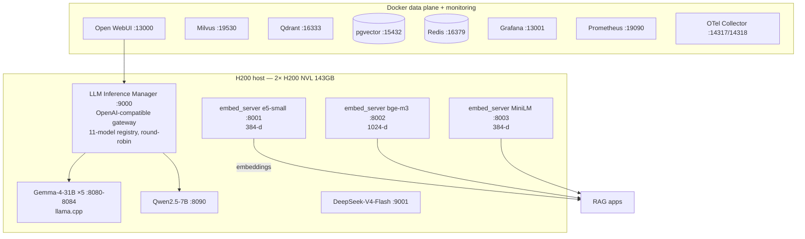
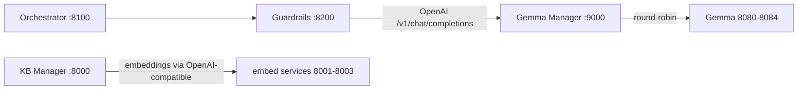
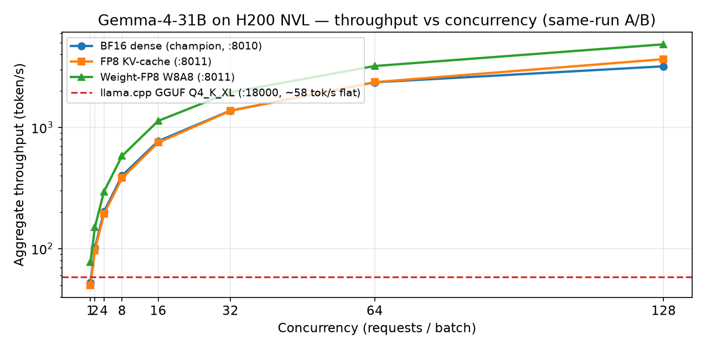
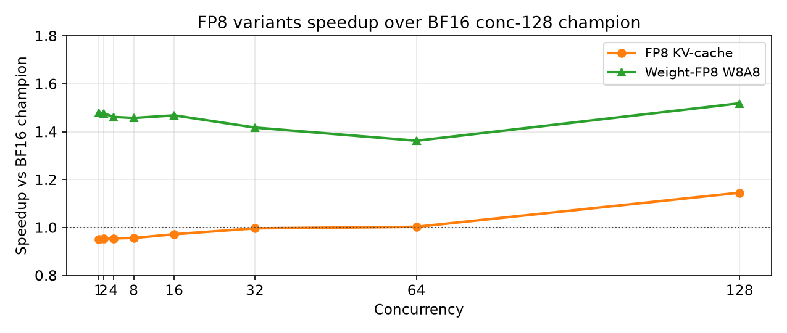
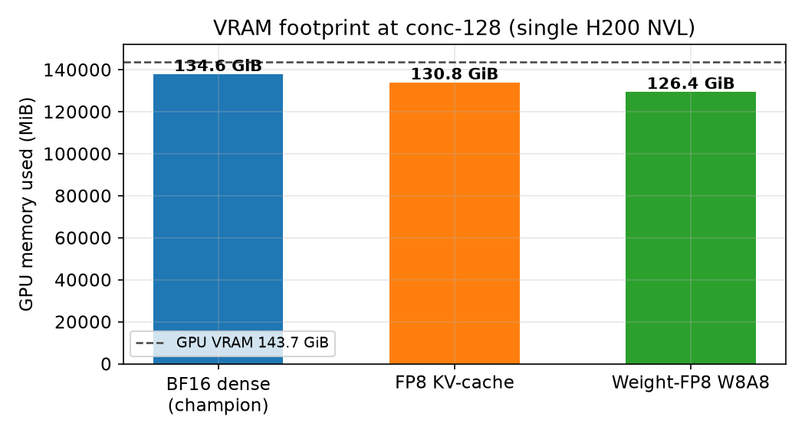

# Work RAG Server Setup — H200 Offline RAG Dev/Prod Environment

Provisioning, local model/embedding services, **Gemma LLM inference manager**, Open WebUI, and infrastructure for the Work Credit RAG platform.

> The full **verified runbook** (live-tested on `ai-gpu1`, 2× NVIDIA H200 NVL) is preserved at [`README.runbook.md`](README.runbook.md). This README gives the module overview, architecture, port map, and progress checklist.

<!-- docs-toc:start -->
## Documentation Index

> Auto-generated from this repository's tracked Markdown notes (**84** files). Refresh with `python scripts/gen_readme_toc.py` — the `docs-toc` workflow does this automatically on push.

### Repository root

- [AGENTS.md](AGENTS.md) — Offline-preparation tooling for a RAG server on an NVIDIA H200 box (ai-gpu1: 2x H200 NVL, driver 580.173.02, CUDA 13.0 runtime). Goal: stage docker i…
- [Work RAG Server Setup — H200 Offline RAG Dev/Prod Environment](README.runbook.md) — Setup and staging of a RAG development + production system on an NVIDIA H200 box behind a corporate Squid proxy. The repo contains orchestration scri…

### `.opencode/`

- [Project Context](.opencode/context.md)
- [Benchmark Harness — cached (verified --help 2026-08-23)](.opencode/docs/benchmark_harness.md) — Source: scripts/ 17 py files, logs logs/evalp.json 20+ files, docs/reports/ 10 png + interactive
- [Evidence T1.1 + T1.2 — Hardware, Proxy & Venv (2026-08-23 13:17 UTC)](.opencode/docs/evidence_T1.1_T1.2.md) — Fixed: Path(__file__).parent / "offline-prep" not Path("/ai-gpu1/v1/Work_RAG-Server-Setup/offline-prep") (old mount stale per AGENTS.md). grep -r ai-…
- [Evidence T1.3 — Model Files Inventory (2026-08-23 13:09 UTC)](.opencode/docs/evidence_T1.3_models.md) — 46 shards confirmed ls .safetensors | wc -l = 46.
- [Evidence T1.4 + T1.5 — Docker Data-Plane & Python Services Verification](.opencode/docs/evidence_T1.4_T1.5_services.md)
- [Evidence T1.6 — Benchmark & Code Verification](.opencode/docs/evidence_T1.6_benchmarks.md) — scripts/rag_test_harness.py exists (95L) — verified above.
- [Evidence T1.7 — README Gap Analysis](.opencode/docs/evidence_T1.7_readme_gaps.md) — wc -l README.md → 803 lines
- [Manager API — cached research (verified 2026-08-23 LIVE on ai-gpu1)](.opencode/docs/manager_api.md) — Source: llm_inference_manager/app.py 580L FastAPI :9000, proxy 192.168.203.2:3128 bypass trust_env=False
- [Models Inventory — cached (du -sh verified 2026-08-23 LIVE)](.opencode/docs/models_inventory.md)
- [OpenCode Integration — cached (verified 2026-08-23 LIVE)](.opencode/docs/opencode_integration.md) — Notes:
- [Mission Status](.opencode/status.md) — M4 Final Verification — COMPLETED (Reviewer gate closed 2026-08-23 13:21 UTC)
- [Mission: Add checked, detailed, step-by-step project run & test README covering ALL models, benchmark code, all code, model files, requirements downloads, plus run Models Manager OpenAI API expose + opencode test session](.opencode/todo.md)
- [Work Log](.opencode/work-log.md)

### `deploy/`

- [Fix: Make real client IP visible behind WAF/VAF (X-Forwarded-For)](deploy/gateway/WAF_XFF_FIX.md) — Added to every location /webui/, /vllm/, /llama/, /embeddings/, /grafana/, /prometheus/, /qdrant/:

### `docs/`

- [RAG Server — Documentation Index](docs/README.md) — A self-hosted RAG + inference platform on 2× NVIDIA H200 NVL (281 GiB total VRAM), 1 TB RAM,
- [RAG Server — System Report & Runbook](docs/REPORT.md) — GATEWAY = http://192.168.96.82:8088 (nginx, also on 192.168.177.10:8088). Firewall open, but run curl --noproxy '' when testing locally (the shell's…
- [Findings — Environment Facts & Gotchas](docs/findings.md) — Verified as of 2026-08-15. Update this file when new facts are learned; keep it current.
- [Gemma 4 31B — 5 Local Instances (OpenAI Compatible)](docs/gemma_endpoints.md)
- [Guide 01 — Hardware & Environment](docs/guides/01-environment.md) — All outbound traffic must go through the corporate Squid proxy:
- [Guide 02 — Inference Engines & Installed Libraries](docs/guides/02-engines-and-libraries.md) — From the model catalog (Guide 05), the mid-2025 engine stack supports:
- [Guide 03 — Services, Ports & Endpoints](docs/guides/03-services-and-endpoints.md) — All services bind 0.0.0.0 → reachable on both host IPs (192.168.96.82, 192.168.177.10).
- [Guide 04 — Docker Images, Containers & Storage](docs/guides/04-docker-and-storage.md) — Saved importable tars of the 5 core images live in offline-prep/docker-images/.tar.
- [Guide 05 — Models Catalog (downloaded / downloading / planned)](docs/guides/05-models-catalog.md) — Location: offline-prep/models/huggingface/<repo with / → _>/; partials under
- [Guide 06 — Model Runnability & Hardware-Fit Matrix](docs/guides/06-model-runnability-fit.md) — gate is engine software support, not memory.
- [Guide 07 — The rag-dl Download Daemon](docs/guides/07-download-daemon.md) — Downloads run as a systemd service so they survive crashes, interrupts, and reboots —
- [Guide 08 — Sample Projects → Dedicated Env + Self-Hosted Endpoint](docs/guides/08-sample-projects.md) — Four upstream projects are cloned under offline-prep/sample-projects/ (upstream repos, do not
- [Guide 09 — Reboot Runbook](docs/guides/09-reboot-runbook.md) — Cleanest sequence to bring this host fully back up. Order matters (containerd before docker,
- [2026-08-10 — Initial Offline Prep Run](docs/history/001_2026-08-10_initial_offline_prep.md) — Pulled and saved to docker-images/.tar:
- [2026-08-11 — Manual Installs, Model Downloads, Docker Load + Healthchecks](docs/history/002_2026-08-11_manual_installs_and_docker.md) — dl_docker.log (14:29–15:03 UTC):
- [2026-08-15 — P0: Environment Stabilization](docs/history/003_2026-08-15_stabilize_environment.md)
- [2026-08-15 — Models, Inference Services, Scipy Fix](docs/history/004_2026-08-15_models_and_services.md)
- [2026-08-15 — HF Token, Download Resumption & Remote-Access Attempts](docs/history/005_2026-08-15_token_and_remote_access.md) — scripts/download_models.py TARGETS) and completes in this order:
- [2026-08-15 — GGUF Inference Verification (batch 1)](docs/history/006_2026-08-15_gguf_inference_verification.md) — (n_gpu_layers=-1, prompt "Write a single short sentence about what a RAG server is.",
- [2026-08-15 — Model Evaluation (Conventional + Persian)](docs/history/007_2026-08-15_model_evaluation.md) — (abstract_algebra, computer_security, high_school_mathematics), Persian ARC-Easy
- [2026-08-16 — Big-Model Inference + Eval (Gemma-4-31B, Nemotron-49B); 72B download resumption](docs/history/008_2026-08-16_big_model_inference_eval.md) — (scripts/verify_gguf_chat.py, applies embedded chat template — required because
- [009 — 2026-08-16: Persian LLM Benchmark Suite & Reports](docs/history/009_2026-08-16_persian_llm_benchmark.md) — Findings:
- [010 — 2026-08-17: Extended Persian Benchmarks (Gemma-3, Qwen3 family), Creative Plots, Auto-git](docs/history/010_2026-08-17_extended_persian_benchmarks.md)
- [011 — 2026-10-12 — Gemma-4 TRT-LLM bring-up, NVIDIA driver mismatch fix](docs/history/011_2026-10-12_trtllm_gemma4_and_driver_fix.md) — Champion is gemma-4-31b. The current optimized/"Triton" path (gemma-4-31b-triton-vllm, :8104) is only a host llama.cpp placeholder (~40 tok/s, speedu…
- [012 — 2026-10-13 — TensorRT-LLM 1.3.0rc29 SERVING gemma-4-31b (four blockers fixed)](docs/history/012_2026-10-13_trtllm_serve_gemma4_up.md) — The 1.3.0rc29 venv installed fine on 2026-10-12 (see 011) but trtllm-serve never came up. Diagnostic tool: py-spy dump on the hung processes.
- [013 — 2026-10-13 — TRT-LLM champion config, concurrency sweep, promotion](docs/history/013_2026-10-13_trtllm_champion_concurrency.md) — Same Persian prompt, max_tokens=256, temp 0.3, 5 repeats, tokens re-encoded with the shared gemma tokenizer (llama.cpp :18000 returns no usage).
- [014 — 2026-10-14 — FP8 variants benchmarked vs BF16 conc-128 champion](docs/history/014_2026-10-14_fp8_kv_weight_benchmark.md) — same Persian long-form prompt, max_tokens=256, temperature=0.3,
- [Execution History](docs/history/README.md) — Detailed, dated record of every installation and notable finding during this RAG server setup. This is the authoritative history — .state.json, logs,…
- [Manager OpenAPI Curls — verified 2026-08-23](docs/manager_openapi_curls.md) — Base: http://127.0.0.1:9000 (local) or http://192.168.96.82:9000 (from Docker) or http://host.docker.internal:9000 (inside container). Auth: Authoriz…
- [Plan Deliverables](docs/plan.md) — Machine-parseable checklist (the progress dashboard reads the [x]/[ ] markers).
- [README Runbook Outline (implemented 2026-08-23)](docs/reports/README_runbook_outline.md) — 0 Quick Start, 1 Hardware/Proxy, 2 Repo Layout, 3 Venv/Requirements, 4 Model Files (17), 5 Docker, 6 Embeds, 7 LLMs (11), 8 Manager, 9 OpenCode, 10 B…
- [Persian LLM Evaluation Report](docs/reports/persian_eval_report.md) — Generated: 2026-08-19 09:18 UTC
- [4e. Prompt engineering — vanilla vs improved, full Q&A](docs/reports/persian_prompt_compare.md) — For each task, the same tricky question is asked twice on a strong model (Gemma-4-31B) and an error-prone model (Mistral-7B): first with the raw data…
- [4c. Sample questions — one tricky prompt per category, all models](docs/reports/persian_sample_questions.md) — For each of the 7 task categories below, a deliberately tricky prompt is shown where the 9 models disagree (best view of real capability). Every mode…

### `docs-site/`

- [Models (sorted by mean accuracy)](docs-site/_reports/01-models-sorted-by-mean-accuracy.md)
- [Model details — architecture, creator, license, deployment](docs-site/_reports/02-model-details-architecture-creator-license-deployment.md) — All nine models were downloaded from the Hugging Face Hub as GGUF weight files, quantized with llama.cpp (Q4_K_M unless noted), and run offline on th…
- [Ability-group scores (radar chart data)](docs-site/_reports/03-ability-group-scores-radar-chart-data.md)
- [Figures](docs-site/_reports/04-figures.md) — Ranked mean accuracy across the 7 Persian tasks. Each model has one color used consistently: solid bar = vanilla prompts, hatched bar = improved prom…
- [Improved prompting vs vanilla](docs-site/_reports/05-improved-prompting-vs-vanilla.md) — Every model was re-run on the full 7-task suite with improved Persian prompts (4-component framework: ROLE + CONTEXT + CONSTRAINTS + OUTPUT FORMAT, k…
- [Few-shot scaling (0/1/2/3/5-shot)](docs-site/_reports/06-few-shot-scaling-0-1-2-3-5-shot.md) — Same task prompts, N correct in-task exemplars prepended before the question. Numbers below are the mean over the 7 tasks; see persian_nshot.png.
- [Effect of temperature](docs-site/_reports/07-effect-of-temperature.md) — Same prompts re-run at increasing sampling temperature (greedy 0.0 baseline → 0.2 / 0.5 / 0.8 / 1.0). Higher temperature = more diverse (but less rep…
- [Sample questions — one tricky prompt per category](docs-site/_reports/07-sample-questions.md) — For each of the 7 task categories below, a deliberately tricky prompt is shown where the 9 models disagree (best view of real capability). Every mode…
- [Prompt engineering — vanilla vs improved full Q&A](docs-site/_reports/08-prompt-engineering-qa.md) — For each task, the same tricky question is asked twice on a strong model (Gemma-4-31B) and an error-prone model (Mistral-7B): first with the raw data…
- [Same question, all models (first example per task)](docs-site/_reports/08-same-question-all-models-first-example-per-task.md) — The same test prompt was sent to every model. Gold answers and per-model outputs show why scores differ (format-following, Persian fluency, reasoning…
- [Embedding model comparison (Persian retrieval)](docs-site/_reports/09-embeddings.md) — A 6-document Persian retrieval benchmark (scripts/test_embeddings.py) checks top-1 retrieval for 6 queries across three locally-served embedders. All…
- [Per-model samples](docs-site/_reports/09-per-model-samples.md) — گزینه‌ها:
- [2026-08-10 — Initial Offline Prep Run](docs-site/_reports/10-history-001_2026-08-10_initial_offline_prep.md) — Pulled and saved to docker-images/.tar:
- [2026-08-11 — Manual Installs, Model Downloads, Docker Load + Healthchecks](docs-site/_reports/11-history-002_2026-08-11_manual_installs_and_docker.md) — dl_docker.log (14:29–15:03 UTC):
- [2026-08-15 — P0: Environment Stabilization](docs-site/_reports/12-history-003_2026-08-15_stabilize_environment.md)
- [2026-08-15 — Models, Inference Services, Scipy Fix](docs-site/_reports/13-history-004_2026-08-15_models_and_services.md)
- [2026-08-15 — HF Token, Download Resumption & Remote-Access Attempts](docs-site/_reports/14-history-005_2026-08-15_token_and_remote_access.md) — scripts/download_models.py TARGETS) and completes in this order:
- [2026-08-15 — GGUF Inference Verification (batch 1)](docs-site/_reports/15-history-006_2026-08-15_gguf_inference_verification.md) — (n_gpu_layers=-1, prompt "Write a single short sentence about what a RAG server is.",
- [2026-08-15 — Model Evaluation (Conventional + Persian)](docs-site/_reports/16-history-007_2026-08-15_model_evaluation.md) — (abstract_algebra, computer_security, high_school_mathematics), Persian ARC-Easy
- [2026-08-16 — Big-Model Inference + Eval (Gemma-4-31B, Nemotron-49B); 72B download resumption](docs-site/_reports/17-history-008_2026-08-16_big_model_inference_eval.md) — (scripts/verify_gguf_chat.py, applies embedded chat template — required because
- [009 — 2026-08-16: Persian LLM Benchmark Suite & Reports](docs-site/_reports/18-history-009_2026-08-16_persian_llm_benchmark.md) — Findings:
- [010 — 2026-08-17: Extended Persian Benchmarks (Gemma-3, Qwen3 family), Creative Plots, Auto-git](docs-site/_reports/19-history-010_2026-08-17_extended_persian_benchmarks.md)
- [Persian LLM Benchmark & Prompt Engineering Report](docs-site/index.md) — Self-hosted GGUF models (2× H200 NVL) evaluated on a 7-task Persian suite

### `e2e-test/`

- [Docker Container Basics](e2e-test/corpus/docker.md) — Docker images are built from layers defined in a Dockerfile. Each RUN instruction creates one
- [NVIDIA GPU Architecture](e2e-test/corpus/gpu.md) — NVIDIA H100 has 132 SMs, 80 GB HBM3 memory at 3.35 TB/s bandwidth, and FP8 tensor core support.
- [Kubernetes Scheduling & Networking](e2e-test/corpus/kubernetes.md) — The Kubernetes scheduler assigns pods to nodes based on resource requests and affinity rules.
- [LLM Inference Optimization](e2e-test/corpus/llm.md) — LLM inference is memory-bandwidth bound: generating one token reads the entire model weights.
- [Observability Stack](e2e-test/corpus/monitoring.md) — Prometheus scrapes metrics over HTTP in the OpenMetrics format. Grafana queries PromQL and
- [PostgreSQL Performance Tuning](e2e-test/corpus/postgresql.md) — PostgreSQL uses a multi-version concurrency control (MVCC) model. The shared_buffers parameter
- [Python Performance](e2e-test/corpus/python.md) — Python 3.12 improved the bytecode interpreter with specialized instructions, giving 10-25%
- [Retrieval-Augmented Generation (RAG)](e2e-test/corpus/rag.md) — RAG combines an information retrieval system with a large language model. Documents are split
- [Redis Data Structures](e2e-test/corpus/redis.md) — Redis is an in-memory key-value store supporting strings, hashes, lists, sets, sorted sets,
- [Web Security Fundamentals](e2e-test/corpus/security.md) — OWASP Top 10 2021 ranks Broken Access Control first. SQL injection is prevented with parameterized
- [Vector Databases Compared](e2e-test/corpus/vector-db.md) — Milvus uses segmented storage with HNSW and IVF indexes; it separates storage (object store)

<!-- docs-toc:end -->

## 1. Summary

This component owns **hardware, model lifecycle, container infrastructure, and frontend wiring**. It is responsible for:

1. Bootstrapping an H200 GPU host behind a corporate Squid proxy (scripts + offline-prep tooling).
2. Running **embedding microservices** (E5-small, BGE-M3, MiniLM) on ports 8001–8003.
3. Running an **LLM Inference Manager** gateway (port 9000) that load-balances 11 GGUF models (Gemma, Qwen, Nemotron, Llama, Mistral, Phi, DeepSeek) via llama.cpp across the two GPUs.
4. A Docker **data plane** (Milvus/Qdrant/pgvector/Redis/Open WebUI) plus a **monitoring stack** (Prometheus/Grafana/OpenTelemetry).
5. A **Persian 7-task benchmark harness** with generated reports and a GitHub Pages docs site.
6. End-to-end corpus + QA-ground-truth fixtures for smoke tests.

---

## 2. Architecture

### 2.1 Service topology



### 2.2 MVP integration point



---

## 3. Core services

### 3.1 Embedding services (`scripts/services/embed_server.py` → `Dockerfile.embed`)

One FastAPI/sentence-transformers server per model, exposing OpenAI-compatible `/v1/embeddings` (plus `/v1/models`, `/health`). L2-normalized float32 vectors.

| Container/service | Model | Dim |
|---|---|---|
| `:8001` | `intfloat/multilingual-e5-small` | 384 |
| `:8002` | `BAAI/bge-m3` | 1024 |
| `:8003` | `paraphrase-multilingual-MiniLM-L12-v2` | 384 |

```bash
curl -s http://127.0.0.1:8001/health   # {"status":"ok","model":"multilingual-e5-small","dim":384}
curl -s -X POST http://127.0.0.1:8001/v1/embeddings \
  -H "Content-Type: application/json" \
  -d '{"input":"گزارش اعتباری","model":"multilingual-e5-small"}'
```

### 3.2 Gemma Manager gateway (`llm_inference_manager/app.py`, port 9000)

A single OpenAI-compatible gateway in front of all llama.cpp backends.

- **11-model registry** (`MODEL_REGISTRY`): gemma-4-31b, gemma-3-27b, qwen3.8-27b, qwen3-30b-a3b, nemotron-49b, qwen2.5-7b, llama-3.2-3b, mistral-7b, phi-3-mini, deepseek-v4-flash, qwen2.5-72b (name/creator/family/params/size_gb/quant/path/context/license/benchmark/status/backends).
- **Round-robin** load balancing across the 5× Gemma backends (8080–8084) + Qwen (8090).
- **Session memory** via SQLite (`manager.db`): `chat_sessions`, `messages`; injects full history when `session_id` is provided.
- **Metrics** (latency per model) exposed via `/admin/metrics`.
- **On-demand model loading** — `/admin/models/load` spawns a new `llama_chat_server.py` on a free 8085–8100 port, auto-picks the GPU with most free memory.
- **Auth**: `verify_token` — anonymous in local dev; Bearer token must match an `api_tokens` row (seeded `sk-local-dev`).
- **Critical proxy fix**: `httpx.AsyncClient(timeout=120, trust_env=False)` bypasses Squid for localhost backends.
- Serves a **single-file HTML dashboard** (`/`, `/dashboard`).

```bash
# Model chat
curl -s http://127.0.0.1:9000/v1/chat/completions -X POST \
  -H "Content-Type: application/json" -H "Authorization: Bearer sk-local-dev" \
  -d '{"model":"gemma-4-31b","messages":[{"role":"user","content":"سلام"}]}'
```

### 3.3 llama.cpp chat server (`scripts/services/llama_chat_server.py`)

OpenAI-compatible per-backend server: `/v1/models`, `/health`, `/v1/chat/completions`, `/v1/completions`. Launched by `gemma_supervisor.sh` (5× Gemma on 8080–8084, GPU split: GPU0→8080/8082/8084, GPU1→8081/8083, infinite auto-restart loop) and by `llama.launch_model`.

---

## 4. Port map

| Port | Service |
|---|---|
| 8001 / 8002 / 8003 | embeddings (e5-small / bge-m3 / MiniLM) |
| 8080–8084 | 5× Gemma-4-31B (llama.cpp) |
| 8090 | Qwen2.5-7B |
| 9000 | **LLM Inference Manager gateway** (OpenAI-compatible) |
| 9001 | DeepSeek-V4-Flash wrapper |
| 9621 | LightRAG |
| 13000 | Open WebUI |
| 15432 | pgvector (Docker) |
| 16333 / 16334 | Qdrant (Docker) |
| 16379 | Redis (Docker) |
| 19530 | Milvus (Docker) |
| 13001 / 19090 / 19100 | Grafana / Prometheus / node-exporter |
| 14317 / 14318 / 19092 | OTel gRPC / HTTP / prometheus export |

---

## 5. Data plane & monitoring (`deploy/`)

### 5.1 docker-compose (`deploy/docker-compose.yml`)

| Container | Port | Purpose |
|---|---|---|
| `redis` | 16379 | cache / queue |
| `qdrant` | 16333 | vector store |
| `pgvector` | 15432 | postgres + pgvector |
| `milvus` | 19530 | vector store (standalone, embedded etcd+MinIO) |
| `open-webui` | 13000 | UI (`WEBUI_AUTH=false`) |

`setup_data_plane.py` idempotently creates the **`rag_docs`** collection (dim 384, COSINE) across all three vector stores and writes `deploy/data_plane_status.json`.

### 5.2 Monitoring (`deploy/monitoring/`)

| Service | Port | Notes |
|---|---|---|
| Prometheus | 19090 | scrapes vLLM `:8000/metrics`, GPU `:9101`, node `:9100`, 15s |
| Grafana | 13001 | auto-provisioned Prometheus datasource |
| OTel collector | 14317/14318/19092 | OTLP gRPC/HTTP + prometheus export |

### 5.3 Gateway (`deploy/gateway/`)

Nginx landing pages for `:8088`/`:8080` reverse-proxying `/vllm/`, `/llama/`, `/embeddings/`, `/webui/`, `/grafana/`, `/prometheus/`, `/qdrant/`, `/milvus/`, `/docs/`. `.public.html` adds HTTP Basic Auth for Cloudflare-tunnel public access.

---

## 6. Offline provisioning behind the proxy

| Script | Purpose |
|---|---|
| `start.sh` | Bootstraps Ubuntu: apt deps, Docker (+ daemon proxy), venv, launches `offline_prepare_cli.py` in tmux |
| `proxy_setup.sh` | Persists Squid proxy env + apt + git + docker daemon config |
| `fix_env.sh` | Rebuilds a broken `prep_venv` (python3.12 + huggingface-hub + transformers) |
| `offline_prepare_cli.py` | Self-healing downloader/installer: state machine + retry queue; downloads Docker images, CUDA/torch wheels, HF models (17 repos), sample projects (Dify, AnythingLLM, RAGFlow, LightRAG) |

All work relative to `offline-prep/` (gitignored: models, tars, wheels, venvs, logs).

---

## 7. Benchmark harness & docs

- `scripts/eval_persian.py` — Persian 7-task evaluation harness.
- `scripts/gen_eval_report.py`, `gen_prompt_compare.py`, `gen_sample_questions.py`, `gen_pages.py` — report/render pipeline.
- `scripts/download_*.py` — proxy-resilient downloads (models, embeddings, eval data, Persian eval).
- `scripts/services/gpu_metrics_exporter.py` — pure-stdlib Prometheus metrics from `nvidia-smi`.
- **Docs site** (GitHub Pages): https://alinikkhah2001.github.io/Work_RAG-Server-Setup/ — benchmark results, plots, history. Built by `.github/workflows/pages.yml` + `docs-site/`.
- `e2e-test/` — `qa_ground_truth.json` (10 QA pairs) + 11 corpus markdown docs consumed by `scripts/rag_test_harness.py`.

---

## 8. Run / verify

```bash
# 1. Provision the host (first time)
bash start.sh                 # then interact with offline-prep CLI in tmux: offline_prep

# 2. Proxy (every shell)
export http_proxy=http://192.168.203.2:3128 https_proxy=http://192.168.203.2:3128
source proxy_setup.sh

# 3. Start services
nvidia-smi                    # expect 2× H200
offline-prep/venv/bin/python3.12 -m pip install -r requirements.txt

docker compose -f deploy/docker-compose.yml up -d
python scripts/services/embed_server.py --model multilingual-e5-small --port 8001 &
python llm_inference_manager/app.py &        # port 9000

# 4. Verify
curl -s http://127.0.0.1:9000/health
curl -s http://127.0.0.1:9000/v1/models
bash llm_inference_manager/test_manager.sh    # curl suite -> logs/manager_test_*.json
```

> **Windows dev tip:** this module is designed for the Linux GPU host. On a local Windows box, the MVP path uses `scripts/mock_gemma_manager.py` in the parent repo instead of the manager — everything downstream (Orchestrator/Guardrails) is agnostic to that because it only talks OpenAI-compatible HTTP.

---

## 9. Repository layout (key entries)

```text
components/server-setup/
├── README.md / README.runbook.md   # module README + preserved verified runbook
├── start.sh / fix_env.sh / proxy_setup.sh / offline_prepare_cli.py
├── Dockerfile.embed
├── deploy/
│   ├── docker-compose.yml / setup_data_plane.py / recreate_webui.sh
│   ├── gateway/                    # nginx landing pages
│   └── monitoring/                 # prometheus, grafana, otel
├── docs/                           # reports, guides, history 001-010
├── docs-site/                      # Jekyll GitHub Pages site
├── e2e-test/                       # QA ground truth + corpus
├── llm_inference_manager/
│   ├── app.py / Dockerfile / requirements.txt / test_manager.sh
└── scripts/
    ├── services/                   # llama_chat_server, embed_server, gpu_metrics_exporter...
    └── ...                            # eval, report, download, verify tooling
```

---

## 10. Planning & progress checklist

### P0 — Host bootstrap (done)

- [x] Hardware/OS verified (2× H200 NVL 143GB, driver 580.173.02, CUDA 13.0)
- [x] Proxy plumbing (env / apt / git / docker daemon)
- [x] `prep_venv` master venv + verification
- [x] `offline_prepare_cli.py` self-healing downloader (Docker images, wheels, HF models, sample projects)
- [x] Docker data plane (redis/qdrant/pgvector/milvus/open-webui) up
- [x] Embedding services live (8001–8003)

### P1 — LLM services (in progress)

- [x] `llama_chat_server.py` OpenAI-compatible backend
- [x] 5× Gemma-4-31B on 8080–8084 (`gemma_supervisor.sh`) + Qwen2.5-7B 8090
- [x] **Gemma Manager gateway :9000** (11-model registry, round-robin, sessions, metrics, dashboard)
- [x] `/v1/models` + `/v1/chat/completions` verified
- [x] `Dockerfile.embed` + `llm_inference_manager/Dockerfile` added (MVP build path)
- [ ] DeepSeek-V4-Flash production load (9001)
- [ ] vLLM single-file GGUF serving on :8000 (nominal, not running)

### P2 — Data plane & monitoring (partially live)

- [x] Milvus/Qdrant/pgvector/Redis collections created (`rag_docs`, dim 384, COSINE)
- [x] Prometheus/Grafana/OTel stack running
- [ ] GPU/metrics dashboards wired into Grafana sub-path
- [ ] LightRAG live wiring on :9621

### P3 — Benchmarks & reports

- [x] Persian 7-task eval harness + reports
- [x] GitHub Pages docs site publishing
- [ ] Re-run eval against current corpus snapshot
- [ ] Speed benchmarks persisted per GGUF

### P4 — E2E & hardening

- [x] `e2e-test/` corpus + QA ground truth + `rag_test_harness.py`
- [x] `trust_env=False` localhost proxy bypass (manager + llama)
- [ ] Re-render runbook paths `/ai-gpu1/...` → live `/splunk-data/v1/...`
- [ ] Auth token rotation + admin RBAC
- [ ] Disk/report retention policy

### P5 — Future

- [ ] Kubernetes rollout (vs compose data plane)
- [ ] GPU auto-scaling model placement
- [ ] Public tunnel hardening (Basic Auth → SSO)

---

## 11. Known gotchas

- `offline-prep/venv/bin/python3.12 -m pip` — **never bare `pip`** (shebangs point at dead `/ai-gpu1/...`).
- `.state.json` / `.retry_queue.json` are stale — treat as history.
- `numpy`/`scipy` conflict → pin `scipy==1.13.1`.
- Localhost calls must bypass the Squid proxy → `trust_env=False`.
- The module is Linux/GPU-oriented; Windows workstations use the parent repo's mock Gemma as a drop-in OpenAI-compatible replacement.

---

## License

See parent repository `LICENSE` and the submodule's own obligations.

## 12. Inference Optimization — TensorRT-LLM Gemma-4-31B champion

### 12.1 Goal

Maximize generation throughput of the champion `gemma-4-31b` model on a single
NVIDIA H200 NVL (143 GiB VRAM) while keeping the full RAG stack intact
(Orchestrator :8100 → Guardrails :8200 → LLM). The champion is served by
TensorRT-LLM 1.3.0rc29 (`trtllm-serve`, OpenAI-compatible `:8010`) and is the
ground-truth generator behind the RAG agent.

### 12.2 Why LLM inference is memory-bandwidth bound

Generating one token requires reading the entire set of model weights from VRAM
(~62 GiB in BF16 for Gemma-4-31B text). On H200 NVL (~3.9 TB/s memory
bandwidth) the single-stream ceiling is therefore roughly 60 tok/s, no matter
how fast the compute is. Throughput only scales above that by **continuous
batching**: many sequences share one weight read, so the weight bandwidth cost
is amortized across the batch until memory bandwidth or power saturates.

### 12.3 How the TRT-LLM optimization works

| Mechanism | What it does | Effect in this setup |
|---|---|---|
| Continuous batching / iteration-level scheduler | New requests are appended as others finish; no head-of-line blocking, SMs stay full | Turns a flat ~58 tok/s single-slot backend into a multi-thousand tok/s aggregate |
| Paged KV cache | KV stored in reusable blocks; no fragmentation, prefix reuse supported | Stable long-context (8192) serving at high concurrency |
| CUDA graphs | Decode step captured for fixed batch sizes; removes CPU launch overhead per token | Fast path only for batch sizes in `cuda_graph_config`; off-graph concurrency collapses ~4× |
| FlashInfer attention | Fused attention kernels supporting arbitrary head dims | Gemma-4 default MMHA asserts on `head_dim=512` (global layers); overridden to `FLASHINFER` |
| FP8 KV cache | KV elements stored in 1 byte instead of 2 | ~4 GiB VRAM saved at conc-128; +15% throughput at 128 |
| W8A8 weight FP8 (ModelOpt) | Weight elements stored in 1 byte instead of 2 | ~8.6 GiB VRAM saved; +34–63% throughput |
| TP = 1 | Single H200 holds the whole model | No inter-GPU communication overhead |
| KV budget | `kv_cache_free_gpu_memory_fraction=0.85`, `max_batch_size=128`, `max_num_tokens=16384`, `max_seq_len=8192` | Concurrency ceiling of 128 on one H200 |

Champion attention options live in `scripts/trtllm_extra_options.yaml`:
`attn_backend: FLASHINFER` + a dense decode `cuda_graph_config` covering batch
sizes up to 128 (dense set, `mode: decode`). The launcher
`scripts/serve_trtllm.sh` wraps `mpirun -n 1 trtllm-llmapi-launch trtllm-serve`
with a composed CUDA 13.2 toolkit (FlashInfer JIT requires `nvcc` from CUDA ≥
12.8) and the venv first on `PATH`.

### 12.4 Blockers fixed to get TRT-LLM serving

1. **MPI_Comm_spawn deadlock** — TRT-LLM's dynamic spawn hangs; fixed by
   launching under `mpirun -n 1` + `trtllm-llmapi-launch` (spawn-proxy IPC path).
2. **Bare `python3` in launcher** — `trtllm-llmapi-launch` calls
   `python3 -m tensorrt_llm.llmapi.mgmn_leader_node`; fixed by putting the
   venv first on `PATH`.
3. **FlashInfer JIT nvcc too old** — needs `--compress-mode=size` (CUDA ≥ 12.8);
   fixed by composing a CUDA 13.2 toolkit from pip packages (`nvidia/cu13`) and
   exporting `CUDA_HOME`/`PATH`/`LD_LIBRARY_PATH`.
4. **gemma-4 `head_dim=512` MMHA assert** — TRT-LLM MMHA kernel rejects
   head size 512 (`tensorrt_llm/common/attentionOp.cpp:2954`); fixed by
   `attn_backend: FLASHINFER` via `--extra_llm_api_options` (explicit options
   win over model defaults).

### 12.5 Known limits

- **Batch-256 graph capture fails** — FlashInfer prefill workspace overflow
  (needs 401 MiB, limit 335 MiB), so concurrency is capped at 128 on one H200
  with 8192 sequence length.
- **FP8 KV cache crashes unpatched** — FlashInfer's arch list `[10,11,12]`
  excludes sm90 (H200); patched `flashinfer/jit/attention/modules.py` to
  `[8,9,10,11,12]` plus `FLASHINFER_CUDA_ARCH_LIST=9.0a`.
- **Weight FP8 needs modelopt** — `nvidia-modelopt` 0.47.0 W8A8 PTQ with 16
  calibration samples produces arithmetically wrong output (e.g. `17*23 → 399`);
  not production-ready until recalibrated with ≥128 samples and an accuracy
  gate.
- **Power capping** — H200 SW power cap settles after ~160 s: burst ~3.8k
  tok/s, sustained ~2.9k tok/s at conc-128.
- **VRAM is tight** — BF16 conc-128 uses ~137.9 GiB of 143.7 GiB.

### 12.6 Benchmark results (same-run A/B)

Same Persian long-form prompt, `max_tokens=256`, `temperature=0.3`, 5 repeats,
tokens counted with the shared Gemma tokenizer (llama.cpp `:18000` returns no
`usage`). Source JSONs: `logs/bench_bf16_vs_fp8kv.json`,
`logs/bench_bf16_vs_wfp8.json`.

| Concurrency | GGUF llama.cpp `:18000` | BF16 TRT-LLM `:8010` | FP8-KV `:8011` | Weight-FP8 `:8011` |
|------------:|------------------------:|---------------------:|---------------:|-------------------:|
| 1 | 57.6 | 52.5 | 49.9 (0.95×) | 77.6 (1.48×) |
| 2 | — | 101.9 | 97.1 (0.95×) | 150.5 (1.48×) |
| 4 | 59.1 | 202.3 | 193.1 (0.95×) | 295.7 (1.46×) |
| 8 | 59.4 | 399.3 | 381.8 (0.96×) | 581.9 (1.46×) |
| 16 | — | 770.8 | 748.9 (0.97×) | 1131.7 (1.46×) |
| 32 | — | 1375.1 | 1370.0 (1.00×) | 1948.9 (1.39×) |
| 64 | — | 2357.7 | 2363.9 (1.00×) | 3212.1 (1.34×) |
| 128 | — | 3194.9 | 3658.6 (**1.15×**) | 4851.7 (**1.63×**) |







Single-stream: BF16 ~52 tok/s vs GGUF ~58 tok/s (near parity — GGUF is Q4
quantized, TRT is BF16). Continuous batching gives roughly **55×–83×**
aggregate speedup over the GGUF placeholder at high concurrency.

### 12.7 How each optimization improved performance

- **Continuous batching** is the dominant lever: without it the GGUF backend
  processes one request at a time (~58 tok/s flat regardless of load); with it
  the same GPU delivers >3000 tok/s aggregate at conc-128.
- **CUDA graphs** remove per-token CPU launch overhead for graph-sized batches.
  Because graphs only exist for configured batch sizes, a dense graph set
  (≤128) is essential — off-graph concurrency runs eager and is ~4× slower.
- **FlashInfer** makes the model runnable at all (default MMHA asserts on
  gemma-4's `head_dim=512` global layers) and supplies fused kernels.
- **FP8 KV cache** halves KV traffic → +15% at conc-128 with **zero quality
  risk** (weights unchanged). Recommended as the next champion restart
  (`TRTLLM_KV_DTYPE=fp8`).
- **Weight FP8** halves weight traffic → +34–63% throughput, but the 16-sample
  calibration checkpoint is numerically wrong; it must not be connected to the
  RAG agent until recalibrated and accuracy-gated.

### 12.8 Current deployment

- **Champion (ground truth):** BF16 conc-128 on `:8010` (GPU0),
  `kv_cache_dtype="auto"`, wired to the orchestrator via Guardrails
  `UPSTREAM_LLM_BASE_URL=http://127.0.0.1:8010/v1`. E2E verified:
  `finish: stop`, 5 citations on in-domain Persian queries.
- **Validated variants** (throwaway `:8011` on GPU1, removed after testing):
  FP8-KV (+15% at 128, safe) and Weight-FP8 (+63% at 128, quality-regressed).
  Neither is promoted yet.

<!-- TRITON-HOURLY-STATUS -->
> **Triton hourly 2026-10-24T11:13:00+00:00** — champion: BF16 conc-128 Gemma-4-31b on :8010 (GPU0), RAG E2E verified (finish: stop, citations: 5); FP8-KV +15% at 128 validated on throwaway :8011; Weight-FP8 +63% but quality-regressed (not promoted).
