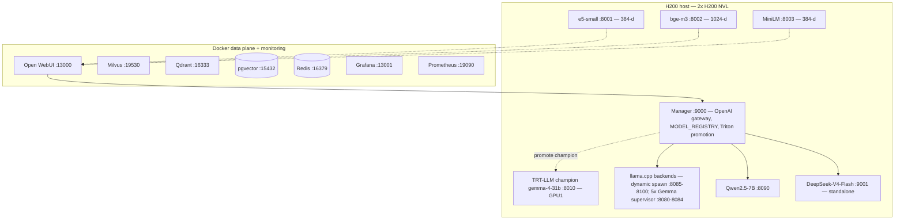
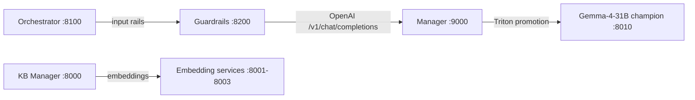
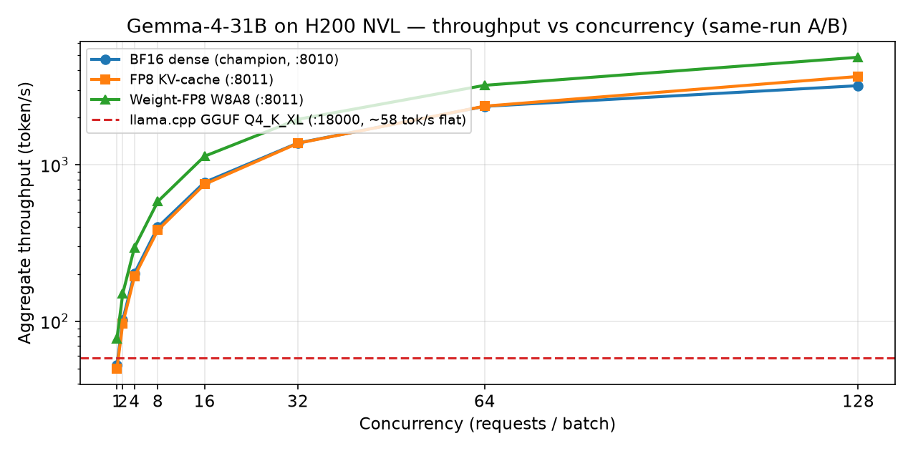
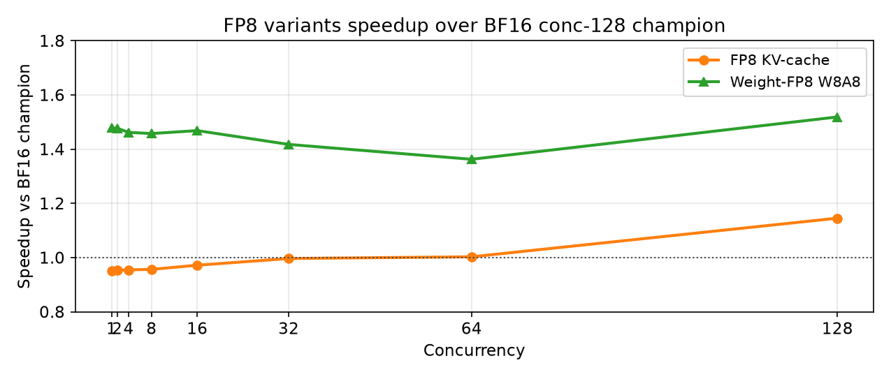
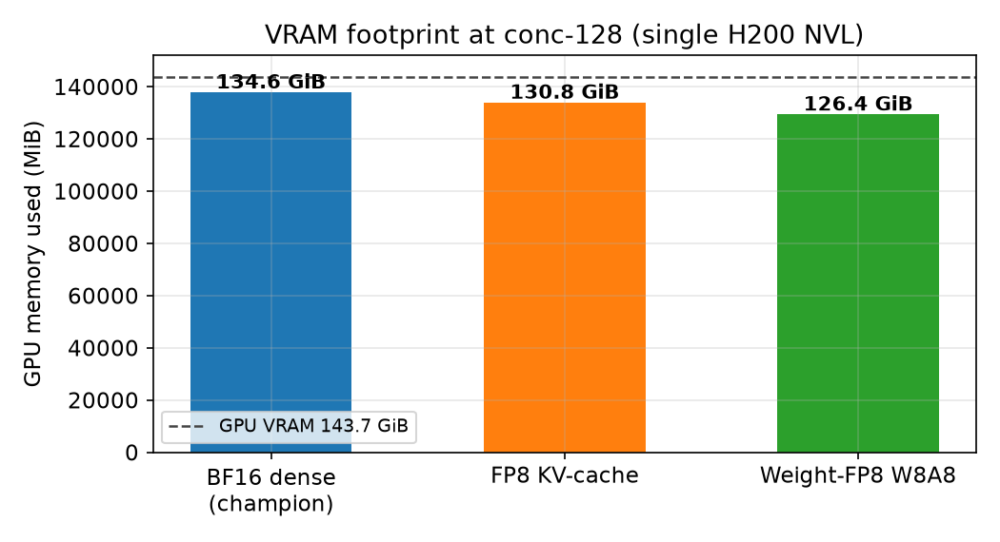

# Work RAG Server Setup — H200 Offline RAG Dev/Prod Environment

Provisioning, local model/embedding services, the **Gemma LLM inference manager** gateway, Open WebUI, and infrastructure for the Work Credit RAG platform. Runs on an NVIDIA H200 host (2× H200 NVL, 281 GiB VRAM) behind a corporate Squid proxy (`http://192.168.203.2:3128`). Working directory: `/splunk-data/v1/Work_RAG-Server-Setup`.

> The live, command-verified runbook is preserved at [`README.runbook.md`](README.runbook.md). This README is the module overview, architecture (validated against `llm_inference_manager/app.py` and `scripts/services/*.py`), port map, and run/verify steps.

---

## 1. Summary

This component owns hardware bootstrapping, model lifecycle, container infrastructure, and frontend wiring. It is responsible for:

* Bootstrapping an H200 GPU host behind a corporate Squid proxy (`start.sh` + `offline_prepare_cli.py`).
* Running **embedding microservices** (multilingual-e5-small, bge-m3, MiniLM) on ports 8001–8003.
* Running the **LLM Inference Manager** gateway (port 9000), an OpenAI-compatible frontend in front of the llama.cpp backends and the TensorRT-LLM Gemma-4-31B champion.
* A Docker **data plane** (Milvus/Qdrant/pgvector/Redis/Open WebUI) plus a **monitoring stack** (Prometheus/Grafana/OTel).
* A **Persian 7-task benchmark harness** with generated reports and plots.

---

<details>
<summary>2. Architecture</summary>

### 2.1 Service topology

The topology below matches the production code in `llm_inference_manager/app.py` (the `MODEL_REGISTRY` and Triton promotion logic) and `scripts/services/`.



**Code truth (validated against `app.py`):**
* `MODEL_REGISTRY` contains two entries: `gemma-4-31b` and `gemma-4-31b-triton-trt`. The gateway does **not** hard-code an 11-model pool; backends are registered dynamically.
* `_triton_promoted_backend()` promotes `gemma-4-31b` to the Triton/TRT-LLM pool when a backend is registered (`/admin/triton/promote`), otherwise falls back to the llama.cpp pool.
* `POST /admin/models/load` spawns `scripts/services/llama_chat_server.py` on a free port in `8085–8100`, picking the GPU with most free VRAM.
* The 5× Gemma llama.cpp supervisor (`scripts/services/gemma_supervisor.sh`) runs independently on `:8080–8084` (GPU0 → 8080/8082/8084, GPU1 → 8081/8083) with an auto-restart loop. It is started separately and is **not** part of `MODEL_REGISTRY` until loaded via the manager.
* `deepseek_server.py` (`:9001`) is a standalone FastAPI wrapper; it is **not** registered in `MODEL_REGISTRY`.

### 2.2 MVP integration point

Request flow (matches the MVP path: Orchestrator → Guardrails → Manager → Gemma):



The Manager exposes `/v1/chat/completions`, `/v1/completions`, `/v1/models`, `/health`, and admin endpoints (`/admin/models/load`, `/admin/models/unload`, `/admin/triton/promote`, `/admin/triton/status`). All outbound HTTP to localhost backends uses `httpx.AsyncClient(timeout=120, trust_env=False)` so calls do not route through the corporate Squid proxy.

### 2.3 TRT-LLM Gemma-4-31B champion (production)

The champion model `gemma-4-31b` is served by **TensorRT-LLM 1.3.0rc29** via `trtllm-serve` (PyTorch backend, `tp_size=1`) on GPU1 port `:8010`, launched by `scripts/serve_trtllm.sh`. It is promoted in the Manager (`POST /admin/triton/promote?backend=trt&url=http://127.0.0.1:8010`) and wired to the orchestrator through Guardrails (`UPSTREAM_LLM_BASE_URL=http://127.0.0.1:8010/v1`).

**Launcher fixes (all required, encoded in `scripts/serve_trtllm.sh`):**
1. `mpirun -n 1 trtllm-llmapi-launch trtllm-serve serve` — avoids the OpenMPI `MPI_Comm_spawn` deadlock; uses the spawn-proxy IPC path.
2. Venv (`offline-prep/venv-trtllm`) first on `PATH` — `trtllm-llmapi-launch` calls bare `python3 -m tensorrt_llm.llmapi.mgmn_leader_node`.
3. Composed CUDA 13.2 toolkit from pip packages (`nvidia-cuda-nvcc==13.2.86`, `nvidia-cuda-crt==13.2.86`, `nvidia-nvvm==13.2.86`) under `site-packages/nvidia/cu13/` — FlashInfer JIT needs `--compress-mode=size` (CUDA ≥ 12.8); host `nvcc` is CUDA 12.0.
4. `attn_backend: FLASHINFER` via `scripts/trtllm_extra_options.yaml` — the default TRTLLM MMHA kernel asserts on Gemma-4's `global_head_dim=512`; FlashInfer tolerates it.

**Champion config:** BF16, `max_batch_size=128`, `max_num_tokens=16384`, `max_seq_len=8192`, `kv_cache_free_gpu_memory_fraction=0.85`, `CUDA_VISIBLE_DEVICES=1`. CUDA graphs are captured only for configured batch sizes (≤ 128); batch-256 graph capture fails (FlashInfer prefill workspace overflow), so 128 is the practical concurrency ceiling.







**Benchmark read-out (same Persian long-form prompt, `max_tokens=256`, `temperature=0.3`, 5 repeats, tokens counted with the shared Gemma tokenizer):**
* Single-stream near parity: GGUF llama.cpp ~58 tok/s vs TRT-LLM BF16 ~50 tok/s (GGUF is Q4 quantized; TRT is BF16).
* Continuous batching: TRT-LLM aggregate scales to ~3874 tok/s at concurrency 128 (~67× the flat ~58 tok/s GGUF placeholder, which does not batch).
* FP8-KV (`TRTLLM_KV_DTYPE=fp8`): ~0.95× at low concurrency, **+15% at conc-128**, zero quality risk (weights unchanged) — the next safe champion restart upgrade.
* Weight-FP8 (ModelOpt W8A8, 16-sample PTQ): +34–63% throughput but arithmetically wrong (`17*23 → 399` vs BF16 `391`) — **not production-ready**; needs ≥128-sample recalibration plus an accuracy gate before connecting to the RAG agent.

</details>

---

<details>
<summary>3. Core services</summary>

### 3.1 Embedding services (`scripts/services/embed_server.py` → `Dockerfile.embed`)

One FastAPI + `sentence_transformers.SentenceTransformer` server per model, exposing OpenAI-compatible `/v1/embeddings` (plus `/v1/models`, `/health`). L2-normalized float32 vectors.

| Port | Model | Dim | HF repo |
|------|-------|-----|---------|
| 8001 | multilingual-e5-small | 384 | intfloat/multilingual-e5-small |
| 8002 | bge-m3 | 1024 | BAAI/bge-m3 |
| 8003 | paraphrase-multilingual-MiniLM-L12-v2 | 384 | sentence-transformers/paraphrase-multilingual-MiniLM-L12-v2 |

```bash
curl -s http://127.0.0.1:8001/health   # {"status":"ok","model":"multilingual-e5-small","dim":384}
curl -s -X POST http://127.0.0.1:8001/v1/embeddings \
  -H "Content-Type: application/json" \
  -d '{"input":"گزارش اعتباری","model":"multilingual-e5-small"}'
```

### 3.2 LLM Inference Manager gateway (`llm_inference_manager/app.py`, port 9000)

A single OpenAI-compatible gateway (`uvicorn.run(app, host="0.0.0.0", port=9000)`) backed by SQLite (`manager.db`).

**Registry (`MODEL_REGISTRY`, `app.py:27`):** two entries — `gemma-4-31b` (GGUF Q4_K_M, 19.6 GB) and `gemma-4-31b-triton-trt` (TRT-LLM FP8 engine). Backends are registered dynamically; the production champion routes to `:8010` via Triton promotion.

**Key behaviors:**
* Round-robin (`pick_backend`, `rr_counters`) over each model's `backends` list. Alias `gemma-4-31b-1` → `gemma-4-31b`; unknown `gemma*` falls back to the `gemma-4-31b` pool.
* **Triton promotion** (`_triton_promoted_backend`): `gemma-4-31b` routes to the optimized Triton/TRT-LLM pool when backends exist, with automatic fallback to the llama.cpp pool.
* Session memory via SQLite: tables `chat_sessions`, `messages`, `metrics`, `api_tokens`; injects full history when `session_id` is provided.
* Metrics (per-model latency) via `/admin/metrics` and `/api/metrics/summary`.
* On-demand model loading: `POST /admin/models/load` spawns `llama_chat_server.py` on a free port `8085–8100`, auto-picks the GPU with most free memory; `POST /admin/models/unload` terminates.
* Auth: `verify_token` — anonymous allowed in local dev; Bearer token must match an `api_tokens` row (seeded `sk-local-dev`) or `LITELLM_MASTER_KEY`.
* Critical proxy fix: `httpx.AsyncClient(timeout=120, trust_env=False)` bypasses Squid for localhost backends (`app.py:301`, `app.py:331`).
* Serves a single-file HTML dashboard (`/`, `/dashboard`) and OpenAPI docs at `/docs`.

```bash
# Model chat
curl -s http://127.0.0.1:9000/v1/chat/completions -X POST \
  -H "Content-Type: application/json" -H "Authorization: Bearer sk-local-dev" \
  -d '{"model":"gemma-4-31b","messages":[{"role":"user","content":"سلام"}]}'

# Admin status + Triton promotion
curl -s http://127.0.0.1:9000/admin/status | jq
curl -s -X POST "http://127.0.0.1:9000/admin/triton/promote?backend=trt&url=http://127.0.0.1:8010" | jq
```

### 3.3 llama.cpp chat server (`scripts/services/llama_chat_server.py`)

Minimal OpenAI-compatible per-backend server: `/v1/models`, `/health`, `/v1/chat/completions`, `/v1/completions`. Backed by `llama_cpp.Llama(model_path, n_ctx, n_gpu_layers=-1)`. Launched by `gemma_supervisor.sh` (5× Gemma on 8080–8084) and by the Manager's `/admin/models/load` (ports 8085–8100).

### 3.4 DeepSeek-V4-Flash wrapper (`scripts/services/deepseek_server.py`, port 9001)

Standalone FastAPI wrapper for DeepSeek-V4-Flash (FP8 MoE 685B) on port 9001. Not registered in `MODEL_REGISTRY`; run independently. Requires the separate `offline-prep/venv-deepseek` (torch 2.8.0+cu128 float8).

</details>

---

<details>
<summary>4. Port map</summary>

| Port | Service |
|------|---------|
| 8001 / 8002 / 8003 | embeddings (e5-small / bge-m3 / MiniLM) |
| 8080–8084 | 5× Gemma-4-31B (llama.cpp, `gemma_supervisor.sh`) |
| 8085–8100 | dynamic llama.cpp backends (Manager `/admin/models/load`) |
| 8090 | Qwen2.5-7B |
| 9000 | **LLM Inference Manager gateway** (OpenAI-compatible) |
| 9001 | DeepSeek-V4-Flash wrapper (standalone) |
| 13000 | Open WebUI (Docker) |
| 15432 | pgvector (Docker) |
| 16333 / 16334 | Qdrant (Docker) |
| 16379 | Redis (Docker) |
| 19530 | Milvus (Docker) |
| 13001 / 19090 | Grafana / Prometheus (Docker) |
| 14317 / 14318 / 19092 | OTel gRPC / HTTP / prometheus export |
| 9101 | GPU metrics exporter (host, `nvidia-smi` → Prometheus) |
| 8010 | TRT-LLM Gemma-4-31B champion (`serve_trtllm.sh`, GPU1) |

</details>

---

<details>
<summary>5. Data plane & monitoring (`deploy/`)</summary>

### 5.1 docker-compose (`deploy/docker-compose.yml`)

| Container | Port | Purpose |
|-----------|------|---------|
| redis | 16379 | cache / queue |
| qdrant | 16333 | vector store |
| pgvector | 15432 | postgres + pgvector |
| milvus | 19530 | vector store (standalone, embedded etcd+MinIO) |
| open-webui | 13000 | UI (`WEBUI_AUTH=false`) |

`deploy/setup_data_plane.py` idempotently creates the **`rag_docs`** collection (dim 384, COSINE) across the vector stores and writes `deploy/data_plane_status.json`.

### 5.2 Monitoring (`deploy/monitoring/`)

| Service | Port | Notes |
|---------|------|-------|
| Prometheus | 19090 | scrapes GPU `:9101`, node `:19100`, 15s |
| Grafana | 13001 | auto-provisioned Prometheus datasource |
| OTel collector | 14317/14318/19092 | OTLP gRPC/HTTP + prometheus export |

### 5.3 Gateway (`deploy/gateway/`)

Nginx landing pages for `:8088` reverse-proxying `/vllm/`, `/llama/`, `/embeddings/`, `/webui/`, `/grafana/`, `/prometheus/`, `/qdrant/`, `/milvus/`, `/docs/`. Test locally with `curl --noproxy '*'` to avoid routing through Squid.

</details>

---

<details>
<summary>6. Offline provisioning behind the proxy</summary>

| Script | Purpose |
|--------|---------|
| `start.sh` | Bootstraps Ubuntu: apt deps, Docker (+ daemon proxy), venv, launches `offline_prepare_cli.py` in tmux |
| `proxy_setup.sh` | Persists Squid proxy env + apt + git + docker daemon config |
| `fix_env.sh` | Rebuilds a broken `prep_venv` (python3.12 + huggingface-hub + transformers) |
| `offline_prepare_cli.py` | Self-healing downloader/installer: state machine + retry queue; downloads Docker images, CUDA/torch wheels, HF models, sample projects (Dify, AnythingLLM, RAGFlow, LightRAG) |

All work relative to `offline-prep/` (gitignored: models, tars, wheels, venvs, logs). `offline_prepare_cli.py:19` sets `BASE_DIR = Path(__file__).resolve().parent / "offline-prep"`.

Run proxy in every shell:
```bash
export http_proxy=http://192.168.203.2:3128 https_proxy=http://192.168.203.2:3128
export no_proxy="localhost,127.0.0.1" NO_PROXY="localhost,127.0.0.1"
source proxy_setup.sh
```

</details>

---

<details>
<summary>7. Libraries & versions</summary>

Installed in the master venv `offline-prep/venv` (Python 3.12.3), per `docs/guides/02-engines-and-libraries.md` and `README.runbook.md`:

| Package | Version | Role |
|---------|---------|------|
| Python | 3.12.3 | runtime |
| fastapi | 0.141.1 | manager / embed / chat servers |
| uvicorn | 0.52.1 | ASGI server |
| httpx | 0.28.1 | backend proxy client (`trust_env=False`) |
| pydantic | — | request models |
| llama-cpp-python | 0.3.34 | GGUF inference (`n_gpu_layers=-1`) |
| sentence-transformers | 5.7.0 | embedding servers |
| torch | 2.4.0+cu124 | CUDA runtime (wheels cu124; host reports CUDA 13.0) |
| torchvision / torchaudio | 0.19.0+cu124 / 2.4.0+cu124 | — |
| vllm | 0.6.1.post1 | GGUF serving (`--load-format gguf --quantization gguf`) |
| flash-attn | 2.6.3 | attention kernels |
| transformers | 4.44.0 | HF model loading |
| sglang | 0.3.0 | installed, not serving |
| faiss-gpu-cu12 | 1.14.1.post1 | vector search |
| bitsandbytes | 0.50.0 | quantization utils |
| accelerate | 1.14.0 | device placement |
| huggingface-hub | 0.36.2 | downloads (`HF_HUB_DISABLE_XET=1`) |
| numpy | 1.26.4 | pinned (vLLM) |
| scipy | 1.13.1 | pinned (do not upgrade) |
| matplotlib | 3.11.1 | benchmark plots |
| datasets | 5.0.1 | eval_persian loads ParsBench |
| deepeval / ragas | 4.1.7 / 0.4.3 | RAG eval |

Isolated TRT-LLM venv `offline-prep/venv-trtllm` (Python 3.12.3): `tensorrt_llm==1.3.0rc29`, `torch==2.14.0` (cu132), `transformers==5.5.4`, `flashinfer-python==0.6.18`, `triton==3.8.0`, `numpy>=2,<2.4`, `torchao>=0.14.1,<0.16.0`, plus composed CUDA 13.2 toolkit (`nvidia-cuda-nvcc/crt/nvvm ==13.2.86`).

</details>

---

<details>
<summary>8. Run / verify</summary>

```bash
# 1. Provision the host (first time)
bash start.sh                 # then interact with offline-prep CLI in tmux: offline_prep

# 2. Proxy (every shell)
export http_proxy=http://192.168.203.2:3128 https_proxy=http://192.168.203.2:3128
export no_proxy="localhost,127.0.0.1" NO_PROXY="localhost,127.0.0.1"
source proxy_setup.sh

# 3. Start services
nvidia-smi                    # expect 2x H200
offline-prep/venv/bin/python3.12 -m pip install -r requirements.txt
docker compose -f deploy/docker-compose.yml up -d
offline-prep/venv/bin/python3.12 scripts/services/embed_server.py \
  --model offline-prep/models/huggingface/intfloat_multilingual-e5-small \
  --model-id multilingual-e5-small --port 8001 &
bash scripts/services/gemma_supervisor.sh  # 5x Gemma 8080-8084
offline-prep/venv/bin/python3.12 llm_inference_manager/app.py &  # port 9000

# 4. Verify
curl -s http://127.0.0.1:9000/health | jq
curl -s http://127.0.0.1:9000/v1/models | jq '.data[].id'
bash llm_inference_manager/test_manager.sh    # curl suite -> logs/manager_test_*.json

# 5. Champion (TRT-LLM) — separate venv, GPU1 :8010
bash scripts/serve_trtllm.sh                  # TRTLLM_VENV=offline-prep/venv-trtllm
curl -s http://127.0.0.1:8010/v1/models | jq
curl -s -X POST "http://127.0.0.1:9000/admin/triton/promote?backend=trt&url=http://127.0.0.1:8010" | jq
```

</details>

---

<details>
<summary>9. Changelog (version summary)</summary>

| Version | Summary |
|---------|---------|
| v1.0 (current, production) | H200 host bootstrapped; Manager :9000 gateway with `MODEL_REGISTRY`, Triton promotion, SQLite sessions/metrics; 5× Gemma llama.cpp on 8080–8084 + Qwen2.5-7B 8090; embeds 8001–8003 live; Docker data plane + monitoring up; TRT-LLM Gemma-4-31B champion on :8010 (GPU1) promoted as ground truth for RAG; Persian 7-task benchmark + docs site. |
| v0.x (history) | Initial offline prep (2026-08-10), manual installs & Docker (2026-08-11), environment stabilization (2026-08-15), models & inference services (2026-08-15), GGUF/Persian evaluation (2026-08-15 to 2026-08-17), TRT-LLM bring-up & driver fix (2026-10-12), TRT-LLM serving (2026-10-13), champion concurrency sweep & promotion (2026-10-13), FP8 KV / weight-FP8 benchmark (2026-10-14). Full per-session detail lives in `docs/history/`. |

</details>

---

<details>
<summary>10. Known gotchas</summary>

* `offline-prep/venv/bin/python3.12 -m pip` — never bare `pip` (venv entry-point shebangs point at the stale `/ai-gpu1/...` mount). Use `python3.12 -m pip`.
* `.state.json` / `.retry_queue.json` under `offline-prep/` are stale — treat as history, not current truth.
* `numpy`/`scipy` conflict — pin `scipy==1.13.1`; do not upgrade numpy past 1.26.4 while vLLM 0.6.1.post1 is in use.
* Localhost calls must bypass the Squid proxy — `trust_env=False` in the Manager (`app.py:301`, `app.py:331`) and `no_proxy=localhost,127.0.0.1` for local `curl` (`curl --noproxy '*'`).
* TRT-LLM requires the isolated `venv-trtllm`; never upgrade the shared live venv's torch/numpy/transformers.
* Batch-256 CUDA graph capture fails (FlashInfer prefill workspace overflow) — concurrency capped at 128 on one H200.
* Weight-FP8 (16-sample ModelOpt checkpoint) is numerically wrong — not production-ready.
* Power capping: batch-128 throughput bursts ~3.8k tok/s then settles ~2.9k tok/s sustained (~160 s).

</details>

---

## License

See parent repository `LICENSE` and the submodule's own obligations.

<<<<<<< Updated upstream
=======
<!-- TRITON-HOURLY-STATUS -->
> **Triton hourly 2026-11-09T19:07:42+00:00** — GGUF 19G | HF gemma-4 59G | HF gemma-3 52K | Engine 0 | Manager manager down | VLLM vllm down | Triton  | triton 8004: down | Bench logs/bench_compare_20261007_120435.json

>>>>>>> Stashed changes

<!-- docs-toc:start -->
## Documentation Index

> Auto-generated from this repository's tracked Markdown notes (**87** files). Refresh with `python scripts/gen_readme_toc.py` — the `docs-toc` workflow does this automatically on push.

### Repository root

- [AGENTS.md](AGENTS.md) — Offline-preparation tooling for a RAG server on an NVIDIA H200 box (ai-gpu1: 2x H200 NVL, driver 580.173.02, CUDA 13.0 runtime). Goal: stage docker i…
- [Work RAG Server Setup — H200 Offline RAG Dev/Prod Environment](README.runbook.md) — Setup and staging of a RAG development + production system on an NVIDIA H200 box behind a corporate Squid proxy. The repo contains orchestration scri…

### `.opencode/`

- [Project Context](.opencode/context.md)
- [Benchmark Harness — cached (verified --help 2026-08-23)](.opencode/docs/benchmark_harness.md) — Source: scripts/ 17 py files, logs logs/evalp.json 20+ files, docs/reports/ 10 png + interactive
- [Evidence T1.1 + T1.2 — Hardware, Proxy & Venv (2026-08-23 13:17 UTC)](.opencode/docs/evidence_T1.1_T1.2.md) — Fixed: Path(__file__).parent / "offline-prep" not Path("/ai-gpu1/v1/Work_RAG-Server-Setup/offline-prep") (old mount stale per AGENTS.md). grep -r ai-…
- [Evidence T1.3 — Model Files Inventory (2026-08-23 13:09 UTC)](.opencode/docs/evidence_T1.3_models.md) — 46 shards confirmed ls .safetensors | wc -l = 46.
- [Evidence T1.4 + T1.5 — Docker Data-Plane & Python Services Verification](.opencode/docs/evidence_T1.4_T1.5_services.md)
- [Evidence T1.6 — Benchmark & Code Verification](.opencode/docs/evidence_T1.6_benchmarks.md) — scripts/rag_test_harness.py exists (95L) — verified above.
- [Evidence T1.7 — README Gap Analysis](.opencode/docs/evidence_T1.7_readme_gaps.md) — wc -l README.md → 803 lines
- [Manager API — cached research (verified 2026-08-23 LIVE on ai-gpu1)](.opencode/docs/manager_api.md) — Source: llm_inference_manager/app.py 580L FastAPI :9000, proxy 192.168.203.2:3128 bypass trust_env=False
- [Models Inventory — cached (du -sh verified 2026-08-23 LIVE)](.opencode/docs/models_inventory.md)
- [OpenCode Integration — cached (verified 2026-08-23 LIVE)](.opencode/docs/opencode_integration.md) — Notes:
- [Mission Status](.opencode/status.md) — M4 Final Verification — COMPLETED (Reviewer gate closed 2026-08-23 13:21 UTC)
- [Mission: Add checked, detailed, step-by-step project run & test README covering ALL models, benchmark code, all code, model files, requirements downloads, plus run Models Manager OpenAI API expose + opencode test session](.opencode/todo.md)
- [Work Log](.opencode/work-log.md)

### `deploy/`

- [Fix: Make real client IP visible behind WAF/VAF (X-Forwarded-For)](deploy/gateway/WAF_XFF_FIX.md) — Added to every location /webui/, /vllm/, /llama/, /embeddings/, /grafana/, /prometheus/, /qdrant/:

### `docs/`

- [Containerization, Scaling & DevOps Report](docs/CONTAINERIZATION_DEVOPS_REPORT.md) — This report provides a complete containerization, scaling, and DevOps architecture for the Work Credit RAG Platform running on a 2× H200 NVL host. It…
- [DevOps, Containerization & Production Deployment Report](docs/DEVOPS_CONTAINERIZATION_REPORT.md) — 1. Executive Summary
- [RAG Server — Documentation Index](docs/README.md) — A self-hosted RAG + inference platform on 2× NVIDIA H200 NVL (281 GiB total VRAM), 1 TB RAM,
- [RAG Server — System Report & Runbook](docs/REPORT.md) — GATEWAY = http://192.168.96.82:8088 (nginx, also on 192.168.177.10:8088). Firewall open, but run curl --noproxy '' when testing locally (the shell's…
- [Findings — Environment Facts & Gotchas](docs/findings.md) — Verified as of 2026-08-15. Update this file when new facts are learned; keep it current.
- [Gemma 4 31B — 5 Local Instances (OpenAI Compatible)](docs/gemma_endpoints.md)
- [Guide 01 — Hardware & Environment](docs/guides/01-environment.md) — All outbound traffic must go through the corporate Squid proxy:
- [Guide 02 — Inference Engines & Installed Libraries](docs/guides/02-engines-and-libraries.md) — From the model catalog (Guide 05), the mid-2025 engine stack supports:
- [Guide 03 — Services, Ports & Endpoints](docs/guides/03-services-and-endpoints.md) — All services bind 0.0.0.0 → reachable on both host IPs (192.168.96.82, 192.168.177.10).
- [Guide 04 — Docker Images, Containers & Storage](docs/guides/04-docker-and-storage.md) — Saved importable tars of the 5 core images live in offline-prep/docker-images/.tar.
- [Guide 05 — Models Catalog (downloaded / downloading / planned)](docs/guides/05-models-catalog.md) — Location: offline-prep/models/huggingface/<repo with / → _>/; partials under
- [Guide 06 — Model Runnability & Hardware-Fit Matrix](docs/guides/06-model-runnability-fit.md) — gate is engine software support, not memory.
- [Guide 07 — The rag-dl Download Daemon](docs/guides/07-download-daemon.md) — Downloads run as a systemd service so they survive crashes, interrupts, and reboots —
- [Guide 08 — Sample Projects → Dedicated Env + Self-Hosted Endpoint](docs/guides/08-sample-projects.md) — Four upstream projects are cloned under offline-prep/sample-projects/ (upstream repos, do not
- [Guide 09 — Reboot Runbook](docs/guides/09-reboot-runbook.md) — Cleanest sequence to bring this host fully back up. Order matters (containerd before docker,
- [2026-08-10 — Initial Offline Prep Run](docs/history/001_2026-08-10_initial_offline_prep.md) — Pulled and saved to docker-images/.tar:
- [2026-08-11 — Manual Installs, Model Downloads, Docker Load + Healthchecks](docs/history/002_2026-08-11_manual_installs_and_docker.md) — dl_docker.log (14:29–15:03 UTC):
- [2026-08-15 — P0: Environment Stabilization](docs/history/003_2026-08-15_stabilize_environment.md)
- [2026-08-15 — Models, Inference Services, Scipy Fix](docs/history/004_2026-08-15_models_and_services.md)
- [2026-08-15 — HF Token, Download Resumption & Remote-Access Attempts](docs/history/005_2026-08-15_token_and_remote_access.md) — scripts/download_models.py TARGETS) and completes in this order:
- [2026-08-15 — GGUF Inference Verification (batch 1)](docs/history/006_2026-08-15_gguf_inference_verification.md) — (n_gpu_layers=-1, prompt "Write a single short sentence about what a RAG server is.",
- [2026-08-15 — Model Evaluation (Conventional + Persian)](docs/history/007_2026-08-15_model_evaluation.md) — (abstract_algebra, computer_security, high_school_mathematics), Persian ARC-Easy
- [2026-08-16 — Big-Model Inference + Eval (Gemma-4-31B, Nemotron-49B); 72B download resumption](docs/history/008_2026-08-16_big_model_inference_eval.md) — (scripts/verify_gguf_chat.py, applies embedded chat template — required because
- [009 — 2026-08-16: Persian LLM Benchmark Suite & Reports](docs/history/009_2026-08-16_persian_llm_benchmark.md) — Findings:
- [010 — 2026-08-17: Extended Persian Benchmarks (Gemma-3, Qwen3 family), Creative Plots, Auto-git](docs/history/010_2026-08-17_extended_persian_benchmarks.md)
- [011 — 2026-10-12 — Gemma-4 TRT-LLM bring-up, NVIDIA driver mismatch fix](docs/history/011_2026-10-12_trtllm_gemma4_and_driver_fix.md) — Champion is gemma-4-31b. The current optimized/"Triton" path (gemma-4-31b-triton-vllm, :8104) is only a host llama.cpp placeholder (~40 tok/s, speedu…
- [012 — 2026-10-13 — TensorRT-LLM 1.3.0rc29 SERVING gemma-4-31b (four blockers fixed)](docs/history/012_2026-10-13_trtllm_serve_gemma4_up.md) — The 1.3.0rc29 venv installed fine on 2026-10-12 (see 011) but trtllm-serve never came up. Diagnostic tool: py-spy dump on the hung processes.
- [013 — 2026-10-13 — TRT-LLM champion config, concurrency sweep, promotion](docs/history/013_2026-10-13_trtllm_champion_concurrency.md) — Same Persian prompt, max_tokens=256, temp 0.3, 5 repeats, tokens re-encoded with the shared gemma tokenizer (llama.cpp :18000 returns no usage).
- [014 — 2026-10-14 — FP8 variants benchmarked vs BF16 conc-128 champion](docs/history/014_2026-10-14_fp8_kv_weight_benchmark.md) — same Persian long-form prompt, max_tokens=256, temperature=0.3,
- [Execution History](docs/history/README.md) — Detailed, dated record of every installation and notable finding during this RAG server setup. This is the authoritative history — .state.json, logs,…
- [Manager OpenAPI Curls — verified 2026-08-23](docs/manager_openapi_curls.md) — Base: http://127.0.0.1:9000 (local) or http://192.168.96.82:9000 (from Docker) or http://host.docker.internal:9000 (inside container). Auth: Authoriz…
- [Containerization Migration Plan — Work_RAG-Server-Setup (H200 Production)](docs/migration/containerization-report.md) — All 8 production services currently run as bare host processes (venvs) or individual Docker containers on the H200 server. This plan containerizes ev…
- [Plan Deliverables](docs/plan.md) — Machine-parseable checklist (the progress dashboard reads the [x]/[ ] markers).
- [README Runbook Outline (implemented 2026-08-23)](docs/reports/README_runbook_outline.md) — 0 Quick Start, 1 Hardware/Proxy, 2 Repo Layout, 3 Venv/Requirements, 4 Model Files (17), 5 Docker, 6 Embeds, 7 LLMs (11), 8 Manager, 9 OpenCode, 10 B…
- [Persian LLM Evaluation Report](docs/reports/persian_eval_report.md) — Generated: 2026-08-19 09:18 UTC
- [4e. Prompt engineering — vanilla vs improved, full Q&A](docs/reports/persian_prompt_compare.md) — For each task, the same tricky question is asked twice on a strong model (Gemma-4-31B) and an error-prone model (Mistral-7B): first with the raw data…
- [4c. Sample questions — one tricky prompt per category, all models](docs/reports/persian_sample_questions.md) — For each of the 7 task categories below, a deliberately tricky prompt is shown where the 9 models disagree (best view of real capability). Every mode…

### `docs-site/`

- [Models (sorted by mean accuracy)](docs-site/_reports/01-models-sorted-by-mean-accuracy.md)
- [Model details — architecture, creator, license, deployment](docs-site/_reports/02-model-details-architecture-creator-license-deployment.md) — All nine models were downloaded from the Hugging Face Hub as GGUF weight files, quantized with llama.cpp (Q4_K_M unless noted), and run offline on th…
- [Ability-group scores (radar chart data)](docs-site/_reports/03-ability-group-scores-radar-chart-data.md)
- [Figures](docs-site/_reports/04-figures.md) — Ranked mean accuracy across the 7 Persian tasks. Each model has one color used consistently: solid bar = vanilla prompts, hatched bar = improved prom…
- [Improved prompting vs vanilla](docs-site/_reports/05-improved-prompting-vs-vanilla.md) — Every model was re-run on the full 7-task suite with improved Persian prompts (4-component framework: ROLE + CONTEXT + CONSTRAINTS + OUTPUT FORMAT, k…
- [Few-shot scaling (0/1/2/3/5-shot)](docs-site/_reports/06-few-shot-scaling-0-1-2-3-5-shot.md) — Same task prompts, N correct in-task exemplars prepended before the question. Numbers below are the mean over the 7 tasks; see persian_nshot.png.
- [Effect of temperature](docs-site/_reports/07-effect-of-temperature.md) — Same prompts re-run at increasing sampling temperature (greedy 0.0 baseline → 0.2 / 0.5 / 0.8 / 1.0). Higher temperature = more diverse (but less rep…
- [Sample questions — one tricky prompt per category](docs-site/_reports/07-sample-questions.md) — For each of the 7 task categories below, a deliberately tricky prompt is shown where the 9 models disagree (best view of real capability). Every mode…
- [Prompt engineering — vanilla vs improved full Q&A](docs-site/_reports/08-prompt-engineering-qa.md) — For each task, the same tricky question is asked twice on a strong model (Gemma-4-31B) and an error-prone model (Mistral-7B): first with the raw data…
- [Same question, all models (first example per task)](docs-site/_reports/08-same-question-all-models-first-example-per-task.md) — The same test prompt was sent to every model. Gold answers and per-model outputs show why scores differ (format-following, Persian fluency, reasoning…
- [Embedding model comparison (Persian retrieval)](docs-site/_reports/09-embeddings.md) — A 6-document Persian retrieval benchmark (scripts/test_embeddings.py) checks top-1 retrieval for 6 queries across three locally-served embedders. All…
- [Per-model samples](docs-site/_reports/09-per-model-samples.md) — گزینه‌ها:
- [2026-08-10 — Initial Offline Prep Run](docs-site/_reports/10-history-001_2026-08-10_initial_offline_prep.md) — Pulled and saved to docker-images/.tar:
- [2026-08-11 — Manual Installs, Model Downloads, Docker Load + Healthchecks](docs-site/_reports/11-history-002_2026-08-11_manual_installs_and_docker.md) — dl_docker.log (14:29–15:03 UTC):
- [2026-08-15 — P0: Environment Stabilization](docs-site/_reports/12-history-003_2026-08-15_stabilize_environment.md)
- [2026-08-15 — Models, Inference Services, Scipy Fix](docs-site/_reports/13-history-004_2026-08-15_models_and_services.md)
- [2026-08-15 — HF Token, Download Resumption & Remote-Access Attempts](docs-site/_reports/14-history-005_2026-08-15_token_and_remote_access.md) — scripts/download_models.py TARGETS) and completes in this order:
- [2026-08-15 — GGUF Inference Verification (batch 1)](docs-site/_reports/15-history-006_2026-08-15_gguf_inference_verification.md) — (n_gpu_layers=-1, prompt "Write a single short sentence about what a RAG server is.",
- [2026-08-15 — Model Evaluation (Conventional + Persian)](docs-site/_reports/16-history-007_2026-08-15_model_evaluation.md) — (abstract_algebra, computer_security, high_school_mathematics), Persian ARC-Easy
- [2026-08-16 — Big-Model Inference + Eval (Gemma-4-31B, Nemotron-49B); 72B download resumption](docs-site/_reports/17-history-008_2026-08-16_big_model_inference_eval.md) — (scripts/verify_gguf_chat.py, applies embedded chat template — required because
- [009 — 2026-08-16: Persian LLM Benchmark Suite & Reports](docs-site/_reports/18-history-009_2026-08-16_persian_llm_benchmark.md) — Findings:
- [010 — 2026-08-17: Extended Persian Benchmarks (Gemma-3, Qwen3 family), Creative Plots, Auto-git](docs-site/_reports/19-history-010_2026-08-17_extended_persian_benchmarks.md)
- [Persian LLM Benchmark & Prompt Engineering Report](docs-site/index.md) — Self-hosted GGUF models (2× H200 NVL) evaluated on a 7-task Persian suite

### `e2e-test/`

- [Docker Container Basics](e2e-test/corpus/docker.md) — Docker images are built from layers defined in a Dockerfile. Each RUN instruction creates one
- [NVIDIA GPU Architecture](e2e-test/corpus/gpu.md) — NVIDIA H100 has 132 SMs, 80 GB HBM3 memory at 3.35 TB/s bandwidth, and FP8 tensor core support.
- [Kubernetes Scheduling & Networking](e2e-test/corpus/kubernetes.md) — The Kubernetes scheduler assigns pods to nodes based on resource requests and affinity rules.
- [LLM Inference Optimization](e2e-test/corpus/llm.md) — LLM inference is memory-bandwidth bound: generating one token reads the entire model weights.
- [Observability Stack](e2e-test/corpus/monitoring.md) — Prometheus scrapes metrics over HTTP in the OpenMetrics format. Grafana queries PromQL and
- [PostgreSQL Performance Tuning](e2e-test/corpus/postgresql.md) — PostgreSQL uses a multi-version concurrency control (MVCC) model. The shared_buffers parameter
- [Python Performance](e2e-test/corpus/python.md) — Python 3.12 improved the bytecode interpreter with specialized instructions, giving 10-25%
- [Retrieval-Augmented Generation (RAG)](e2e-test/corpus/rag.md) — RAG combines an information retrieval system with a large language model. Documents are split
- [Redis Data Structures](e2e-test/corpus/redis.md) — Redis is an in-memory key-value store supporting strings, hashes, lists, sets, sorted sets,
- [Web Security Fundamentals](e2e-test/corpus/security.md) — OWASP Top 10 2021 ranks Broken Access Control first. SQL injection is prevented with parameterized
- [Vector Databases Compared](e2e-test/corpus/vector-db.md) — Milvus uses segmented storage with HNSW and IVF indexes; it separates storage (object store)

<!-- docs-toc:end -->
