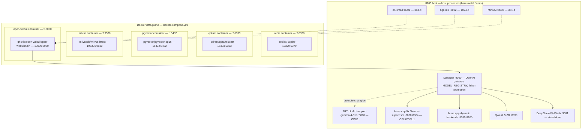
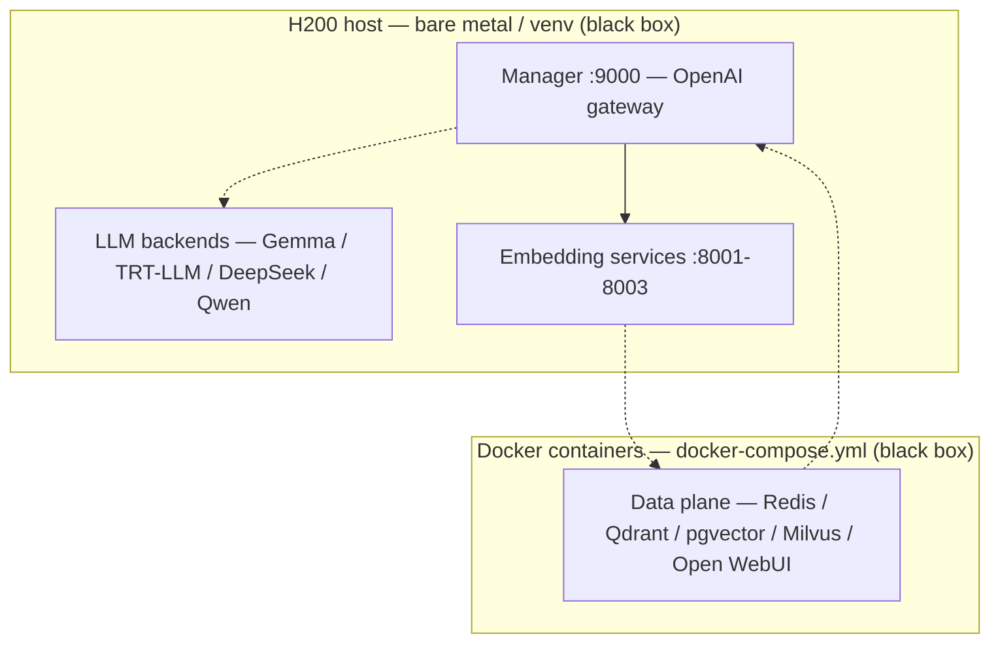
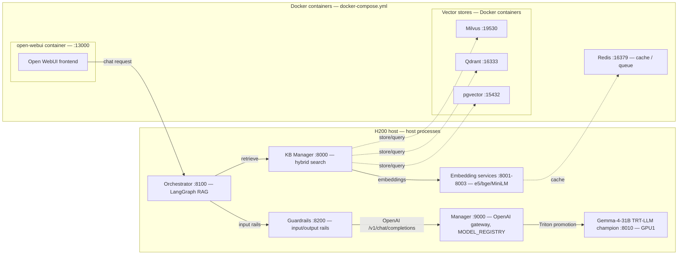
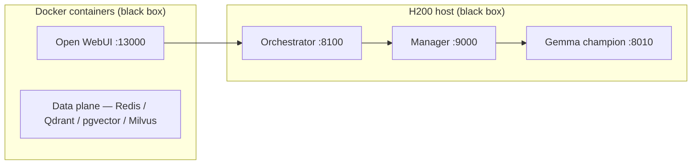
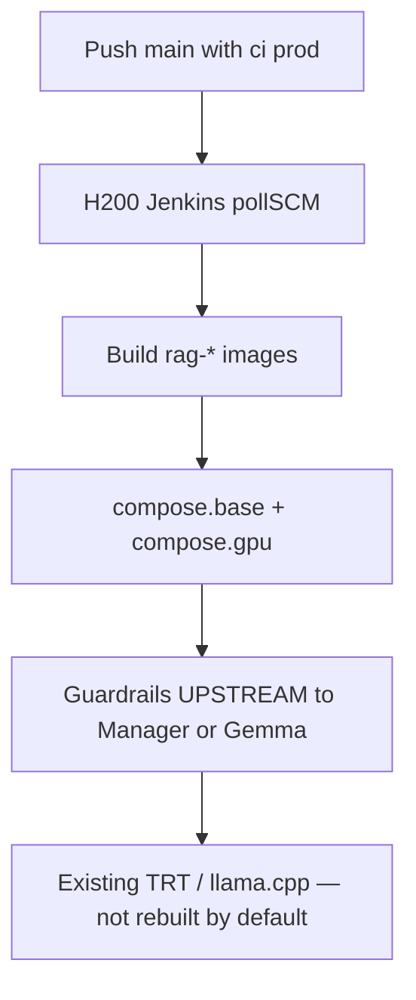

# Work RAG Server Setup — H200 Offline RAG Dev/Prod Environment

Provisioning, local model/embedding services, the **Gemma LLM inference manager** gateway, Open WebUI, and infrastructure for the Work Credit RAG platform. Runs on an NVIDIA H200 host (2× H200 NVL, 281 GiB VRAM) behind a corporate Squid proxy (`http://192.168.203.2:3128`). Working directory: `/splunk-data/v1/Work_RAG-Server-Setup`.

> The live, command-verified runbook is preserved at [`README.runbook.md`](README.runbook.md). This README is the module overview, architecture (validated against `llm_inference_manager/app.py` and `scripts/services/*.py`), port map, and run/verify steps.

---

## 1. Summary

This component owns hardware bootstrapping, model lifecycle, container infrastructure, and frontend wiring. It is responsible for:

* Bootstrapping an H200 GPU host behind a corporate Squid proxy (`start.sh` + `offline_prepare_cli.py`).
* Running **embedding microservices** (multilingual-e5-small, bge-m3, MiniLM) on ports 8001–8003.
* Running the **LLM Inference Manager** gateway (port 9000), an OpenAI-compatible frontend in front of the llama.cpp backends and the TensorRT-LLM Gemma-4-31B champion.
* A Docker **data plane** (Milvus/Qdrant/pgvector/Redis/Open WebUI) plus a **monitoring stack** (Prometheus/Grafana/OTel).
* A **Persian 7-task benchmark harness** with generated reports and plots.

---

<details>
<summary>2. Architecture</summary>

### 2.1 Service topology

The topology below matches the production code in `llm_inference_manager/app.py` (the `MODEL_REGISTRY` and Triton promotion logic) and `scripts/services/`.

#### Detailed technical view — host processes and Docker containers

### Caption: Service topology — detailed technical view: H200 host processes + Docker data plane containers (docker-compose.yml)



#### High-level black box view — abstraction boundary

### Caption: Service topology — high-level black box view (H200 host vs Docker data plane)



**Code truth (validated against `app.py`):**
* `MODEL_REGISTRY` contains two entries: `gemma-4-31b` and `gemma-4-31b-triton-trt`. The gateway does **not** hard-code an 11-model pool; backends are registered dynamically.
* `_triton_promoted_backend()` promotes `gemma-4-31b` to the Triton/TRT-LLM pool when a backend is registered (`/admin/triton/promote`), otherwise falls back to the llama.cpp pool.
* `POST /admin/models/load` spawns `scripts/services/llama_chat_server.py` on a free port in `8085–8100`, picking the GPU with most free VRAM.
* The 5× Gemma llama.cpp supervisor (`scripts/services/gemma_supervisor.sh`) runs independently on `:8080–8084` (GPU0 → 8080/8082/8084, GPU1 → 8081/8083) with an auto-restart loop. It is started separately and is **not** part of `MODEL_REGISTRY` until loaded via the manager.
* `deepseek_server.py` (`:9001`) is a standalone FastAPI wrapper; it is **not** registered in `MODEL_REGISTRY`.

### 2.2 MVP integration point

Request flow (matches the MVP path: Orchestrator → Guardrails → Manager → Gemma):

#### Detailed technical view — MVP request flow with Docker data plane

### Caption: MVP integration point — detailed technical view (Orchestrator → Guardrails → Manager → Gemma + Docker data plane)



#### High-level black box view — MVP abstraction boundary

### Caption: MVP integration point — high-level black box view (host vs Docker boundary)



The Manager exposes `/v1/chat/completions`, `/v1/completions`, `/v1/models`, `/health`, and admin endpoints (`/admin/models/load`, `/admin/models/unload`, `/admin/triton/promote`, `/admin/triton/status`). All outbound HTTP to localhost backends uses `httpx.AsyncClient(timeout=120, trust_env=False)` so calls do not route through the corporate Squid proxy.

### 2.3 TRT-LLM Gemma-4-31B champion (production)

The champion model `gemma-4-31b` is served by **TensorRT-LLM 1.3.0rc29** via `trtllm-serve` (PyTorch backend, `tp_size=1`) on GPU1 port `:8010`, launched by `scripts/serve_trtllm.sh`. It is promoted in the Manager (`POST /admin/triton/promote?backend=trt&url=http://127.0.0.1:8010`) and wired to the orchestrator through Guardrails (`UPSTREAM_LLM_BASE_URL=http://127.0.0.1:8010/v1`).

**Launcher fixes (all required, encoded in `scripts/serve_trtllm.sh`):**
1. `mpirun -n 1 trtllm-llmapi-launch trtllm-serve serve` — avoids the OpenMPI `MPI_Comm_spawn` deadlock; uses the spawn-proxy IPC path.
2. Venv (`offline-prep/venv-trtllm`) first on `PATH` — `trtllm-llmapi-launch` calls bare `python3 -m tensorrt_llm.llmapi.mgmn_leader_node`.
3. Composed CUDA 13.2 toolkit from pip packages (`nvidia-cuda-nvcc==13.2.86`, `nvidia-cuda-crt==13.2.86`, `nvidia-nvvm==13.2.86`) under `site-packages/nvidia/cu13/` — FlashInfer JIT needs `--compress-mode=size` (CUDA ≥ 12.8); host `nvcc` is CUDA 12.0.
4. `attn_backend: FLASHINFER` via `scripts/trtllm_extra_options.yaml` — the default TRTLLM MMHA kernel asserts on Gemma-4's `global_head_dim=512`; FlashInfer tolerates it.

**Champion config:** BF16, `max_batch_size=128`, `max_num_tokens=16384`, `max_seq_len=8192`, `kv_cache_free_gpu_memory_fraction=0.85`, `CUDA_VISIBLE_DEVICES=1`. CUDA graphs are captured only for configured batch sizes (≤ 128); batch-256 graph capture fails (FlashInfer prefill workspace overflow), so 128 is the practical concurrency ceiling.


**Benchmark read-out (same Persian long-form prompt, `max_tokens=256`, `temperature=0.3`, 5 repeats, tokens counted with the shared Gemma tokenizer):**
* Single-stream near parity: GGUF llama.cpp ~58 tok/s vs TRT-LLM BF16 ~50 tok/s (GGUF is Q4 quantized; TRT is BF16).
* Continuous batching: TRT-LLM aggregate scales to ~3874 tok/s at concurrency 128 (~67× the flat ~58 tok/s GGUF placeholder, which does not batch).
* FP8-KV (`TRTLLM_KV_DTYPE=fp8`): ~0.95× at low concurrency, **+15% at conc-128**, zero quality risk (weights unchanged) — the next safe champion restart upgrade.
* Weight-FP8 (ModelOpt W8A8, 16-sample PTQ): +34–63% throughput but arithmetically wrong (`17*23 → 399` vs BF16 `391`) — **not production-ready**; needs ≥128-sample recalibration plus an accuracy gate before connecting to the RAG agent.

</details>

---

<details>
<summary>3. Core services</summary>

### 3.1 Embedding services (`scripts/services/embed_server.py` → `Dockerfile.embed`)

One FastAPI + `sentence_transformers.SentenceTransformer` server per model, exposing OpenAI-compatible `/v1/embeddings` (plus `/v1/models`, `/health`). L2-normalized float32 vectors.

| Port | Model | Dim | HF repo |
|------|-------|-----|---------|
| 8001 | multilingual-e5-small | 384 | intfloat/multilingual-e5-small |
| 8002 | bge-m3 | 1024 | BAAI/bge-m3 |
| 8003 | paraphrase-multilingual-MiniLM-L12-v2 | 384 | sentence-transformers/paraphrase-multilingual-MiniLM-L12-v2 |

```bash
curl -s http://127.0.0.1:8001/health   # {"status":"ok","model":"multilingual-e5-small","dim":384}
curl -s -X POST http://127.0.0.1:8001/v1/embeddings \
  -H "Content-Type: application/json" \
  -d '{"input":"گزارش اعتباری","model":"multilingual-e5-small"}'
```

### 3.2 LLM Inference Manager gateway (`llm_inference_manager/app.py`, port 9000)

A single OpenAI-compatible gateway (`uvicorn.run(app, host="0.0.0.0", port=9000)`) backed by SQLite (`manager.db`).

**Registry (`MODEL_REGISTRY`, `app.py:27`):** two entries — `gemma-4-31b` (GGUF Q4_K_M, 19.6 GB) and `gemma-4-31b-triton-trt` (TRT-LLM FP8 engine). Backends are registered dynamically; the production champion routes to `:8010` via Triton promotion.

**Key behaviors:**
* Round-robin (`pick_backend`, `rr_counters`) over each model's `backends` list. Alias `gemma-4-31b-1` → `gemma-4-31b`; unknown `gemma*` falls back to the `gemma-4-31b` pool.
* **Triton promotion** (`_triton_promoted_backend`): `gemma-4-31b` routes to the optimized Triton/TRT-LLM pool when backends exist, with automatic fallback to the llama.cpp pool.
* Session memory via SQLite: tables `chat_sessions`, `messages`, `metrics`, `api_tokens`; injects full history when `session_id` is provided.
* Metrics (per-model latency) via `/admin/metrics` and `/api/metrics/summary`.
* On-demand model loading: `POST /admin/models/load` spawns `llama_chat_server.py` on a free port `8085–8100`, auto-picks the GPU with most free memory; `POST /admin/models/unload` terminates.
* Auth: `verify_token` — anonymous allowed in local dev; Bearer token must match an `api_tokens` row (seeded `sk-local-dev`) or `LITELLM_MASTER_KEY`.
* Critical proxy fix: `httpx.AsyncClient(timeout=120, trust_env=False)` bypasses Squid for localhost backends (`app.py:301`, `app.py:331`).
* Serves a single-file HTML dashboard (`/`, `/dashboard`) and OpenAPI docs at `/docs`.

```bash
# Model chat
curl -s http://127.0.0.1:9000/v1/chat/completions -X POST \
  -H "Content-Type: application/json" -H "Authorization: Bearer sk-local-dev" \
  -d '{"model":"gemma-4-31b","messages":[{"role":"user","content":"سلام"}]}'

# Admin status + Triton promotion
curl -s http://127.0.0.1:9000/admin/status | jq
curl -s -X POST "http://127.0.0.1:9000/admin/triton/promote?backend=trt&url=http://127.0.0.1:8010" | jq
```

### 3.3 llama.cpp chat server (`scripts/services/llama_chat_server.py`)

Minimal OpenAI-compatible per-backend server: `/v1/models`, `/health`, `/v1/chat/completions`, `/v1/completions`. Backed by `llama_cpp.Llama(model_path, n_ctx, n_gpu_layers=-1)`. Launched by `gemma_supervisor.sh` (5× Gemma on 8080–8084) and by the Manager's `/admin/models/load` (ports 8085–8100).

### 3.4 DeepSeek-V4-Flash wrapper (`scripts/services/deepseek_server.py`, port 9001)

Standalone FastAPI wrapper for DeepSeek-V4-Flash (FP8 MoE 685B) on port 9001. Not registered in `MODEL_REGISTRY`; run independently. Requires the separate `offline-prep/venv-deepseek` (torch 2.8.0+cu128 float8).

</details>

---

<details>
<summary>4. Port map</summary>

| Port | Service |
|------|---------|
| 8001 / 8002 / 8003 | embeddings (e5-small / bge-m3 / MiniLM) |
| 8080–8084 | 5× Gemma-4-31B (llama.cpp, `gemma_supervisor.sh`) |
| 8085–8100 | dynamic llama.cpp backends (Manager `/admin/models/load`) |
| 8090 | Qwen2.5-7B |
| 9000 | **LLM Inference Manager gateway** (OpenAI-compatible) |
| 9001 | DeepSeek-V4-Flash wrapper (standalone) |
| 13000 | Open WebUI (Docker) |
| 15432 | pgvector (Docker) |
| 16333 / 16334 | Qdrant (Docker) |
| 16379 | Redis (Docker) |
| 19530 | Milvus (Docker) |
| 13001 / 19090 | Grafana / Prometheus (Docker) |
| 14317 / 14318 / 19092 | OTel gRPC / HTTP / prometheus export |
| 9101 | GPU metrics exporter (host, `nvidia-smi` → Prometheus) |
| 8010 | TRT-LLM Gemma-4-31B champion (`serve_trtllm.sh`, GPU1) |

</details>

---

<details>
<summary>5. Data plane & monitoring (`deploy/`)</summary>

### 5.1 docker-compose (`deploy/docker-compose.yml`)

| Container | Port | Purpose |
|-----------|------|---------|
| redis | 16379 | cache / queue |
| qdrant | 16333 | vector store |
| pgvector | 15432 | postgres + pgvector |
| milvus | 19530 | vector store (standalone, embedded etcd+MinIO) |
| open-webui | 13000 | UI (`WEBUI_AUTH=false`) |

`deploy/setup_data_plane.py` idempotently creates the **`rag_docs`** collection (dim 384, COSINE) across the vector stores and writes `deploy/data_plane_status.json`.

### 5.2 Monitoring (`deploy/monitoring/`)

| Service | Port | Notes |
|---------|------|-------|
| Prometheus | 19090 | scrapes GPU `:9101`, node `:19100`, 15s |
| Grafana | 13001 | auto-provisioned Prometheus datasource |
| OTel collector | 14317/14318/19092 | OTLP gRPC/HTTP + prometheus export |

### 5.3 Gateway (`deploy/gateway/`)

Nginx landing pages for `:8088` reverse-proxying `/vllm/`, `/llama/`, `/embeddings/`, `/webui/`, `/grafana/`, `/prometheus/`, `/qdrant/`, `/milvus/`, `/docs/`. Test locally with `curl --noproxy '*'` to avoid routing through Squid.

</details>

---

<details>
<summary>6. Offline provisioning behind the proxy</summary>

| Script | Purpose |
|--------|---------|
| `start.sh` | Bootstraps Ubuntu: apt deps, Docker (+ daemon proxy), venv, launches `offline_prepare_cli.py` in tmux |
| `proxy_setup.sh` | Persists Squid proxy env + apt + git + docker daemon config |
| `fix_env.sh` | Rebuilds a broken `prep_venv` (python3.12 + huggingface-hub + transformers) |
| `offline_prepare_cli.py` | Self-healing downloader/installer: state machine + retry queue; downloads Docker images, CUDA/torch wheels, HF models, sample projects (Dify, AnythingLLM, RAGFlow, LightRAG) |

All work relative to `offline-prep/` (gitignored: models, tars, wheels, venvs, logs). `offline_prepare_cli.py:19` sets `BASE_DIR = Path(__file__).resolve().parent / "offline-prep"`.

Run proxy in every shell:
```bash
export http_proxy=http://192.168.203.2:3128 https_proxy=http://192.168.203.2:3128
export no_proxy="localhost,127.0.0.1" NO_PROXY="localhost,127.0.0.1"
source proxy_setup.sh
```

</details>

---

<details>
<summary>7. Libraries & versions</summary>

Installed in the master venv `offline-prep/venv` (Python 3.12.3), per `docs/guides/02-engines-and-libraries.md` and `README.runbook.md`:

| Package | Version | Role |
|---------|---------|------|
| Python | 3.12.3 | runtime |
| fastapi | 0.141.1 | manager / embed / chat servers |
| uvicorn | 0.52.1 | ASGI server |
| httpx | 0.28.1 | backend proxy client (`trust_env=False`) |
| pydantic | — | request models |
| llama-cpp-python | 0.3.34 | GGUF inference (`n_gpu_layers=-1`) |
| sentence-transformers | 5.7.0 | embedding servers |
| torch | 2.4.0+cu124 | CUDA runtime (wheels cu124; host reports CUDA 13.0) |
| torchvision / torchaudio | 0.19.0+cu124 / 2.4.0+cu124 | — |
| vllm | 0.6.1.post1 | GGUF serving (`--load-format gguf --quantization gguf`) |
| flash-attn | 2.6.3 | attention kernels |
| transformers | 4.44.0 | HF model loading |
| sglang | 0.3.0 | installed, not serving |
| faiss-gpu-cu12 | 1.14.1.post1 | vector search |
| bitsandbytes | 0.50.0 | quantization utils |
| accelerate | 1.14.0 | device placement |
| huggingface-hub | 0.36.2 | downloads (`HF_HUB_DISABLE_XET=1`) |
| numpy | 1.26.4 | pinned (vLLM) |
| scipy | 1.13.1 | pinned (do not upgrade) |
| matplotlib | 3.11.1 | benchmark plots |
| datasets | 5.0.1 | eval_persian loads ParsBench |
| deepeval / ragas | 4.1.7 / 0.4.3 | RAG eval |

Isolated TRT-LLM venv `offline-prep/venv-trtllm` (Python 3.12.3): `tensorrt_llm==1.3.0rc29`, `torch==2.14.0` (cu132), `transformers==5.5.4`, `flashinfer-python==0.6.18`, `triton==3.8.0`, `numpy>=2,<2.4`, `torchao>=0.14.1,<0.16.0`, plus composed CUDA 13.2 toolkit (`nvidia-cuda-nvcc/crt/nvvm ==13.2.86`).

</details>

---

<details>
<summary>8. Run / verify</summary>

```bash
# 1. Provision the host (first time)
bash start.sh                 # then interact with offline-prep CLI in tmux: offline_prep

# 2. Proxy (every shell)
export http_proxy=http://192.168.203.2:3128 https_proxy=http://192.168.203.2:3128
export no_proxy="localhost,127.0.0.1" NO_PROXY="localhost,127.0.0.1"
source proxy_setup.sh

# 3. Start services
nvidia-smi                    # expect 2x H200
offline-prep/venv/bin/python3.12 -m pip install -r requirements.txt
docker compose -f deploy/docker-compose.yml up -d
offline-prep/venv/bin/python3.12 scripts/services/embed_server.py \
  --model offline-prep/models/huggingface/intfloat_multilingual-e5-small \
  --model-id multilingual-e5-small --port 8001 &
bash scripts/services/gemma_supervisor.sh  # 5x Gemma 8080-8084
offline-prep/venv/bin/python3.12 llm_inference_manager/app.py &  # port 9000

# 4. Verify
curl -s http://127.0.0.1:9000/health | jq
curl -s http://127.0.0.1:9000/v1/models | jq '.data[].id'
bash llm_inference_manager/test_manager.sh    # curl suite -> logs/manager_test_*.json

# 5. Champion (TRT-LLM) — separate venv, GPU1 :8010
bash scripts/serve_trtllm.sh                  # TRTLLM_VENV=offline-prep/venv-trtllm
curl -s http://127.0.0.1:8010/v1/models | jq
curl -s -X POST "http://127.0.0.1:9000/admin/triton/promote?backend=trt&url=http://127.0.0.1:8010" | jq
```

</details>

---

<details>
<summary>9. Changelog (version summary)</summary>

| Version | Summary |
|---------|---------|
| v1.0 (current, production) | H200 host bootstrapped; Manager :9000 gateway with `MODEL_REGISTRY`, Triton promotion, SQLite sessions/metrics; 5× Gemma llama.cpp on 8080–8084 + Qwen2.5-7B 8090; embeds 8001–8003 live; Docker data plane + monitoring up; TRT-LLM Gemma-4-31B champion on :8010 (GPU1) promoted as ground truth for RAG; Persian 7-task benchmark + docs site. |
| v0.x (history) | Initial offline prep (2026-08-10), manual installs & Docker (2026-08-11), environment stabilization (2026-08-15), models & inference services (2026-08-15), GGUF/Persian evaluation (2026-08-15 to 2026-08-17), TRT-LLM bring-up & driver fix (2026-10-12), TRT-LLM serving (2026-10-13), champion concurrency sweep & promotion (2026-10-13), FP8 KV / weight-FP8 benchmark (2026-10-14). Full per-session detail lives in `docs/history/`. |

</details>

---

<details>
<summary>10. Known gotchas</summary>

* `offline-prep/venv/bin/python3.12 -m pip` — never bare `pip` (venv entry-point shebangs point at the stale `/ai-gpu1/...` mount). Use `python3.12 -m pip`.
* `.state.json` / `.retry_queue.json` under `offline-prep/` are stale — treat as history, not current truth.
* `numpy`/`scipy` conflict — pin `scipy==1.13.1`; do not upgrade numpy past 1.26.4 while vLLM 0.6.1.post1 is in use.
* Localhost calls must bypass the Squid proxy — `trust_env=False` in the Manager (`app.py:301`, `app.py:331`) and `no_proxy=localhost,127.0.0.1` for local `curl` (`curl --noproxy '*'`).
* TRT-LLM requires the isolated `venv-trtllm`; never upgrade the shared live venv's torch/numpy/transformers.
* Batch-256 CUDA graph capture fails (FlashInfer prefill workspace overflow) — concurrency capped at 128 on one H200.
* Weight-FP8 (16-sample ModelOpt checkpoint) is numerically wrong — not production-ready.
* Power capping: batch-128 throughput bursts ~3.8k tok/s then settles ~2.9k tok/s sustained (~160 s).

</details>

---

## Jenkins / CI on H200 (first-time GPU server setup)

This submodule stays the **GPU / TRT / Manager** owner. Parent repo owns the Multibranch [`Jenkinsfile`](../../Jenkinsfile) and [`deploy/jenkins/`](../../deploy/jenkins/). Use the same commit-message keys as the parent README:

| Token | Meaning |
|-------|---------|
| $\textcolor{red}{\textbf{[ci skip]}}$ | Skip |
| $\textcolor{red}{\textbf{[ci build]}}$ | Build images |
| $\textcolor{red}{\textbf{[ci stage]}}$ | Unattended stage (`develop`) |
| $\textcolor{red}{\textbf{[ci prod]}}$ | Unattended prod (`main`) — **no approval** |
| $\textcolor{red}{\textbf{[ci auto]}}$ | Unattended stage or prod by branch |

**No Cloudflare webhook** — Jenkins `pollSCM` every hour.

### One-time bring-up on the GPU host (first-boot checklist)

Parent overview: umbrella `README.md` → **Server first-boot checklist**. Operator twin: `deploy/jenkins/README.md`.

**Important:** Laptop and GPU each have their own Jenkins. Reusing `dana-jenkins:lts` does **not** copy admin password or jobs. Migrate `jenkins_home` only if you intentionally want that.

1. **Prereqs:** Docker Engine, NVIDIA Container Toolkit, `nvidia-smi` OK, GitHub PAT for clone.
2. **Clone umbrella** (not only this submodule):

```bash
git clone --recurse-submodules https://github.com/AliNikkhah2001/Work_Credit-RAG_Phase1.git
cd Work_Credit-RAG_Phase1
```

3. **Self-hosted LLM path first** (do this before CI deploys traffic):
   - Manager `:9000` + embeds `:8001–8003` (this repo), and/or
   - TRT-LLM champion `:8010` via `scripts/serve_trtllm.sh`, and/or
   - parent `deploy/vast/start.sh` / `deploy/docker/docker-compose.yml` for Gemma `:18000`.
4. **Prod env** (`deploy/compose/.env.prod`, gitignored):

```bash
DANA_ENV=prod
DANA_HOST=gpu
LLM_UPSTREAM_MODE=self_hosted
UPSTREAM_LLM_BASE_URL=http://127.0.0.1:9000/v1   # or :18000/v1
UPSTREAM_LLM_MODEL=gemma-4-31b
KB_EMBED_DEVICE=cuda
KB_RERANKER_DEVICE=cuda
```

5. **Patch Jenkins compose for this host:** in `deploy/jenkins/docker-compose.yml`, replace the Mac bind path with this server’s absolute clone path (same path in container + host). Set `DANA_HOST_REPO` to match.
6. **Jenkins container:**

```bash
docker compose -f deploy/jenkins/docker-compose.yml up -d --build
# UI on :8085 — new admin password if jenkins_home is fresh
```

7. **Credentials on GPU Jenkins:** GitHub PAT only (`github-pat`). **Do not** put OpenRouter keys on the GPU host.
8. **Multibranch job** `dana-rag` → GitHub `Work_Credit-RAG_Phase1` → prefer **`main` only** on GPU (laptop keeps `develop` / stage). Jenkinsfile at root. Hourly poll or Scan Now.
9. **Agent env:** `DANA_HOST=gpu` so prod uses `compose.gpu.yml`.
10. **Trigger unattended prod** from your laptop:

```bash
git checkout main
git commit --allow-empty -m "chore: promote stage pins [ci prod]"
git push origin main
# Within ~1 hour (or Scan Now) GPU Jenkins builds and deploys with compose.gpu.yml
```

11. **Verify:** `curl` Manager/Gemma health, then orchestrator `:8100` chat; confirm `LLM_UPSTREAM_MODE=self_hosted` (no LiteLLM container required).
12. **Backup (optional but recommended):** snapshot the `jenkins_home` Docker volume after the job works.

Architecture reminder: generation stays on **TRT / llama.cpp / Manager**; CI only rebuilds/restarts app containers (KB, guardrails, orchestrator, webui) unless you explicitly change model-serving scripts.



---

## License

See parent repository `LICENSE` and the submodule's own obligations.


<!-- TRITON-HOURLY-STATUS -->
> **Triton hourly 2026-11-09T20:07:47+00:00** — GGUF 19G | HF gemma-4 59G | HF gemma-3 52K | Engine 0 | Manager {"detail":"Not Found"} | VLLM vllm down | Triton  | triton 8004: down | Bench logs/bench_compare_20261007_120435.json

