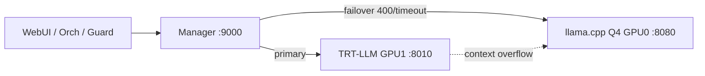

# LLM fallback — TRT primary (GPU1) + llama.cpp secondary (GPU0)

**Date:** 2026-11-16  
**Host:** ai-gpu1 (2× H200 NVL)

## Symptom

Long WebUI threads returned Persian «خطا در پردازش درخواست.»  
TRT log showed **context overflow**, not classic VRAM OOM:

```text
RequestError: default_max_tokens (-N) must be greater than 0
  = max_seq_len (8192) - splited_prompt_len (>8192)
→ HTTP 400 from :8010
```

Live `trtllm_serve.log` had **212** such errors and **0** `CUDA out of memory` hits
at investigation time. GPU1 was ~133 GiB / 143 GiB used; GPU0 was ~3.5 GiB (idle).

## Architecture

```text
                    ┌─────────────────────────────┐
 WebUI / Orch /     │  LLM Manager :9000          │
 Guardrails  ──────►│  model=gemma-4-31b          │
                    └──────────┬──────────────────┘
                               │
              1) try TRT       │        2) on 400 / timeout / down
                               ▼
                    ┌──────────────────────┐     ┌──────────────────────────┐
                    │ TRT-LLM Gemma        │     │ llama.cpp Q4 GGUF        │
                    │ GPU1  :8010          │────►│ GPU0  :8080              │
                    │ max_seq_len = 8192   │     │ n_ctx = 16384            │
                    │ ~133 GiB VRAM        │     │ ~20 GiB VRAM             │
                    └──────────────────────┘     └──────────────────────────┘
```



## Why llama.cpp (not a second TRT) as secondary

| Option | VRAM on free GPU0 | Ops risk | Helps overflow >8192? |
|---|---|---|---|
| **llama.cpp Q4 (chosen)** | ~20 GiB, proven GGUF | Low — one Python server | Yes (`n_ctx=16384`) |
| Second TRT BF16/FP8 | 60–130 GiB + KV | High — toolkit / rebuild / graphs | Only if rebuilt with larger `max_seq_len` |

llama.cpp is the **most stable** second option: same weights family, no TRT stack coupling,
loads on idle GPU0 in minutes, and Manager already had a llama pool concept (8080–8084).

## Related PRs (merged to `develop` 2026-11-16)

| Repo | PR | Role |
|---|---|---|
| Guardrails | #8 | Stream path catches upstream 400 → safe SSE |
| Orchestrator | #25 | `UPSTREAM_LLM_*` for rewrite; soft-fail retrieve |
| Phase1 | #91 | Compose wires `UPSTREAM_LLM_*` + stress QA |

These improve UX/resilience; **Manager failover + GPU0 process** fix capacity.

## Ops commands

```bash
# Start / ensure GPU0 fallback
cd /splunk-data/production/Work_Credit-RAG_Phase1/components/server-setup
bash scripts/serve_llamacpp_fallback.sh

# Manager must run the updated app.py (failover on non-200)
curl -sS http://127.0.0.1:9000/admin/fallback/status | jq .

# Smoke: force a short chat via manager
curl -sS http://127.0.0.1:9000/v1/chat/completions \
  -H 'Content-Type: application/json' \
  -d '{"model":"gemma-4-31b","messages":[{"role":"user","content":"سلام"}],"max_tokens":64}'
```

Env overrides:

- `TRT_BACKEND_URL` (default `http://127.0.0.1:8010`)
- `LLAMACPP_FALLBACK_URL` (default `http://127.0.0.1:8080`)
- `GUARD_UPSTREAM_CHAR_BUDGET` (default `18000`) — trim before TRT
- `CUDA_VISIBLE_DEVICES` / `PORT` / `N_CTX` for the fallback script

## Do not

- Remount host docker into Jenkins (separate issue; see `imagebugfix.txt`)
- Point both registry entries only at `:8010` with no `:8080`
- Assume HealthCheck **HEALTHY** means LLM long-threads are fine — check TRT log / Manager metrics
